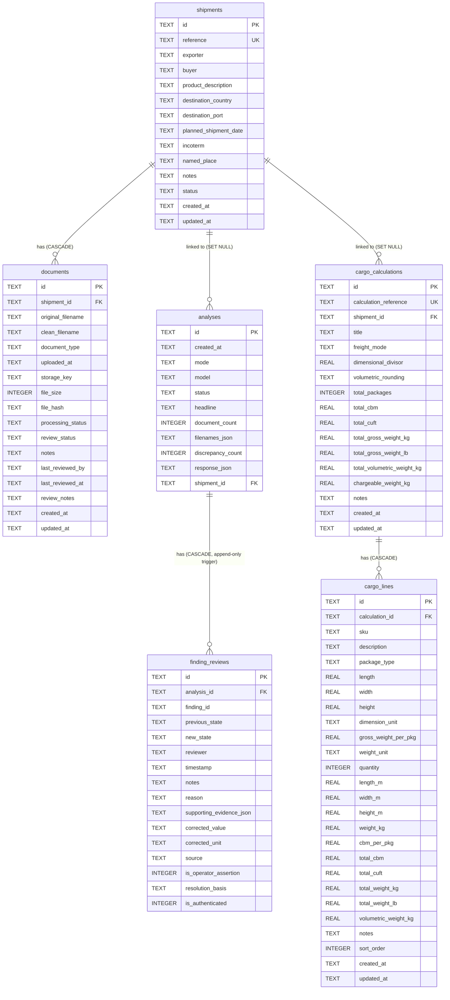

# TradeSathi AI — ExportMate ERP Baseline Audit & Architecture Report
**Document Version:** `1.0.0`  
**Audit Date:** `2026-10-14`  
**Execution Context:** Windows (PowerShell), Localhost  
**Target Product Phase:** ExportMate (Export Trading ERP)  
**Deferred Future Phase:** PortSathi (Port Operations & Shipping Agency Management)  
**Safety Status:** Live database and live storage protected. Zero live data modified.

---

## 1. Executive Summary

TradeSathi AI is an active, production-grade local-first export documentation, reconciliation, and logistics planning platform. It features an automated multi-document analysis engine, an evidence-grounded discrepancy detection system, a tamper-resistant human review audit trail, a shipment readiness evaluation pipeline, a CBM cargo measurement calculator, and automated disaster-recovery tooling.

The objective of the **ExportMate ERP Expansion** is to evolve TradeSathi AI from a document audit and cargo-planning utility into an end-to-end export trading ERP—spanning **Master Data (Products, Suppliers, Customers)**, **Procurement & Goods Receipt**, **Inventory & Warehouse Management**, **Sales Orders & Fulfilment**, **Shipment Allocation**, **GST-Aware Invoicing & Payments**, **Multi-Currency Accounting**, and **Operational Profitability Dashboards**.

This audit establishes the baseline facts of the repository as of October 14, 2026, without modifying live data or breaking existing features.

---

## 2. Git Status and Repository Baseline

### 2.1 Git Repository State
- **Branch:** `main` (up to date with `origin/main`).
- **Pre-existing Working Tree Modifications:**
  - Modified tracked files:
    - `.gitignore`
    - `README.md`
    - `backend/.env.example`
    - `backend/app/analysis.py`
    - `backend/app/db.py`
    - `backend/app/documents.py`
    - `backend/app/main.py`
    - `backend/app/readiness.py`
    - `backend/app/schemas.py`
    - `backend/app/storage.py`
    - `frontend/.env.example`
    - `frontend/index.html`
    - `frontend/package.json`
    - `frontend/src/App.jsx`
    - `frontend/src/styles.css`
    - `frontend/vite.config.js`
  - Pre-existing untracked files:
    - Operational runbooks: `DEPLOYMENT.md`, `RECOVERY_RUNBOOK.md`
    - Scripts: `start.bat`, `stop.bat`, `scripts/test-recovery.ps1`
    - Backend modules: `backend/app/backup.py`, `backend/app/cbm_engine.py`, `backend/app/recovery_verifier.py`, `backend/app/review.py`
    - Test suites: 14 test files in `backend/tests/`, 8 test files in `frontend/test/`
    - Frontend components & helpers: `frontend/src/CbmCalculator.jsx`, `frontend/src/api.js`, `frontend/src/cbmHelper.js`, `frontend/src/reportHelper.js`
    - Historical verification artifacts: 5 PNG verification screenshots, 12 disaster recovery reports in `reports/recovery/`
- **Rule of Preservation:** None of the user's uncommitted changes will be discarded, overwritten, or reset.

### 2.2 Live Database Baseline
Inspection of `backend/tradesathi.db` (read-only SQLite check via `PRAGMA integrity_check` and `PRAGMA foreign_key_check`):
- **Integrity Status:** `ok`
- **Foreign Key Violations:** `0`
- **Current Live Row Counts (Pre-Pytest vs Post-Pytest Investigation):**
  - Initial inspection count: `shipments`: 43, `documents`: 46, `analyses`: 320, `finding_reviews`: 2.
  - Post-pytest count: `shipments`: 45, `documents`: 48, `analyses`: 330, `finding_reviews`: 2.
  - **Critical Root Cause Discovery:** Investigation identified that only `test_shipments.py` and `test_audit_history.py` had defined local `isolated_db` fixtures. In contrast, `test_confidence_reconciliation.py` (line 507, creating `SHP-2E2-...`) and `test_evidence_traceability.py` (line 244, creating `SHP-E2E-...`) were invoking `TestClient(app)` without an isolated database fixture, causing them to write to the default `backend/tradesathi.db`.
  - Historical database inspection confirmed this has occurred across past test runs (e.g. `SHP-E2E-A256DF` and `SHP-2E2-356D97` on Oct 13), explaining why the live database grew from 25 to 43+ shipments.
  - **Required Immediate Action for Phase 1:** Implement a root `backend/tests/conftest.py` with an autouse fixture setting `set_db_path()` and `set_storage_dir()` to temporary test directories for ALL test suites, guaranteeing 100% database isolation across every test execution.
- **Live Physical Stored Documents:** **114** files across shipment folders in `backend/storage/documents/` (historical snapshot baseline in backup was 78).
- **Active Ports:** Ports `8000`, `8001`, and `5173` were checked via TCP connection probe and verified **CLOSED** (no background processes running).

---

## 3. Current Implemented, Partially Implemented, and Missing Features

| Business Domain | Feature Area | Current Status | Implemented Details / Repository Evidence | What Is Missing for ExportMate ERP |
|---|---|:---:|---|---|
| **Shipments** | Shipment Workspaces | **Implemented** | CRUD endpoints (`/api/shipments`), status tracking (`draft`, `in_progress`, `ready`, etc.), reference uniqueness, incoterms, ports, dates. | Direct linkage to Sales Orders, partial shipment allocations, multi-order consolidation. |
| **Documents** | Document Register & Storage | **Implemented** | Safe filesystem storage (`backend/storage/documents/<shipment_id>/`), SHA-256 hash calculation, deduplication detection, safe download endpoint (`/api/documents/{id}/download`), review status (`uploaded`, `verified_by_user`, `needs_review`, `not_applicable`). | Configurable document checklist rules by destination country/commodity; automatic tagging by PO/SO. |
| **Analysis** | Multi-Document Extraction | **Implemented** | PDF, DOCX, TXT, EML parsing (`pypdf`, `python-docx`, standard library). Hybrid extraction: local Ollama (`llama3.2`, `qwen2.5`) with full deterministic regex/rules fallback (`rules_extract`). Character offsets and line-level coordinate tracking. | SKU-level matching to product master catalog; multi-currency price parsing tied to live exchange rates. |
| **Audit & Review** | Discrepancy & Human Review | **Implemented** | Cross-document field reconciliation (invoice vs packing list vs PO), grounded evidence references, unit ambiguity blockers, legal state transitions (`pending_review` → `in_review` → `acknowledged` → `resolved`), SQLite trigger preventing update of historical reviews (`trg_prevent_review_update`). | Approval hierarchy for credit/financial discrepancy overrides. |
| **Readiness** | Export Readiness Scorecard | **Implemented** | `calculate_shipment_readiness` evaluating document presence, open critical discrepancies, and human verification status. Explicit disclaimer that readiness does not certify statutory customs clearance. | Linkage to export declarations, shipping bills, LUT status, and payment receipt milestones. |
| **Logistics** | Cargo Measurements & CBM | **Implemented** | `cbm_engine.py`, `CbmCalculator.jsx`, volumetric weight divisors (air 6000, sea 5000/1000), 20ft/40ft/40ft HC container capacity optimization, CSV export, standalone and shipment-linked calculations. | Integration with warehouse dispatch picking and packing lists. |
| **Disaster Recovery** | Automated DR Tooling | **Implemented** | `backup.py`, `recovery_verifier.py`, `scripts/test-recovery.ps1`. 10 automated health, checksum, integrity, and API checks against isolated mock server. | Continuous cloud snapshot replication (local SQLite snapshot tool is fully functional). |
| **Master Data** | Product Master | **Missing** | Only ad-hoc product descriptions in shipments and extracted line items exist. | Dedicated Product Master table (`products`), SKUs, units of measure, HSN/SAC codes, default buy/sell prices, categories, weights, barcodes. |
| **Master Data** | Supplier / Vendor Master | **Missing** | Exporter field in shipment is a plain string. | Supplier master table (`suppliers`), GSTIN/tax IDs, contacts, payment terms, currency preferences, bank details, supplier price lists. |
| **Master Data** | Customer & CRM | **Missing** | Buyer field in shipment is a plain string. | Customer master table (`customers`), billing/shipping addresses, GSTIN/tax IDs, payment terms, credit terms, customer currency. |
| **Procurement** | Purchase Orders & Receipt | **Missing** | PO documents can be uploaded and extracted, but no procurement transactional state exists. | Purchase Orders (`purchase_orders`), PO line items (`purchase_order_lines`), partial Goods Receipts (`goods_receipts`), quality inspection / quarantine quantities, inventory posting. |
| **Inventory** | Warehouses & Stock Ledger | **Missing** | None. Stock is not tracked. | Warehouse master (`warehouses`), transactional immutable stock ledger (`stock_movements`), reservations for sales orders, available vs physical stock formula, adjustments. |
| **Sales** | Sales Orders & Fulfilment | **Missing** | None. Orders start directly as shipments. | Sales Orders (`sales_orders`), SO lines (`sales_order_lines`), stock reservations, shipment allocations (`shipment_allocations`), partial fulfilment, delivery confirmation. |
| **Customs** | Export Declarations & Customs | **Partially Implemented** | Port of loading, port of discharge, HS codes extracted from documents. | Formal tracking of Shipping Bill / Export Declaration numbers, customs broker details, customs status milestones, export duty/drawback references. |
| **Invoicing & GST**| Billing & Invoices | **Missing** | Commercial invoices are parsed as documents, but internal ERP invoices and billing workflows do not exist. | Sales Invoices (`invoices`), line items (`invoice_lines`), Indian GST calculations (CGST, SGST, IGST, export under LUT / bond), payment records (`payments`), payment allocations. |
| **Finance** | Multi-Currency & Profitability | **Missing** | Currency strings extracted from invoices; cross-currency comparison blocks discrepancies. | Exchange rates table (`exchange_rates`) with historical rate locking, shipment direct costs (`shipment_expenses`), estimated vs confirmed revenue, estimated vs realized gross margin reporting. |
| **Dashboard** | Business Overview KPIs | **Partially Implemented** | Top summary tiles show shipment counts and recent audit statistics. | True ERP operational dashboard: open POs, open SOs, pending goods receipts, available/reserved stock, unpaid customer invoices, unpaid supplier bills, estimated vs realized margin. |
| **Barcode** | Barcode Management | **Missing** | None. | SKU barcode generation, printable label view, manual barcode scanning input for receipt and picking. |
| **Portals** | Customer & Supplier Portals | **Deferred** | None. | Role-based portal access deferred to post-core ERP phase. |
| **PortSathi** | Marine & Port Operations | **Deferred** | Static roadmap placeholder tab in frontend (`App.jsx`, `activeWorkspace === 'port'`). | Vessel calls, tug/barge logs, port dues, laytime/SOF reconciliation deferred to future phase. |

---

## 4. Existing Database Tables and Relationships



### Table Relationships & Integrity Constraints
1. **Foreign Keys:** Enforced via `PRAGMA foreign_keys = ON` on every connection.
2. **Append-Only Trigger:** `trg_prevent_review_update` triggers `RAISE(ABORT)` on any `UPDATE` on `finding_reviews`.
3. **Write-Ahead Logging:** `PRAGMA journal_mode = WAL` is enabled for high concurrency.
4. **Busy Timeout:** `PRAGMA busy_timeout = 30000` (30 seconds) prevents lock collision errors.

---

## 5. Existing API Routes Baseline

A total of 34 application and utility routes are registered on the FastAPI backend:

### Shipments API
- `POST /api/shipments` — Create a new shipment workspace.
- `GET /api/shipments` — List shipments with search, status filter, and pagination.
- `GET /api/shipments/{shipment_id}` — Get single shipment details with counts.
- `PATCH /api/shipments/{shipment_id}` — Update shipment fields.
- `DELETE /api/shipments/{shipment_id}` — Delete shipment and cascade related records.
- `GET /api/shipments/{shipment_id}/readiness` — Calculate export readiness scorecard.
- `POST /api/shipments/{shipment_id}/reconcile` — Execute cross-document audit on attached docs.
- `GET /api/shipments/{shipment_id}/analyses` — List analyses run for a shipment.
- `GET /api/shipments/{shipment_id}/cargo-measurements` — List CBM calculations linked to shipment.

### Document Register API
- `POST /api/shipments/{shipment_id}/documents` — Upload documents with hashing and path safety.
- `GET /api/shipments/{shipment_id}/documents` — List documents for shipment.
- `GET /api/shipments/{shipment_id}/documents/{document_id}` — Get document metadata.
- `PATCH /api/shipments/{shipment_id}/documents/{document_id}` — Update document review status / notes.
- `DELETE /api/shipments/{shipment_id}/documents/{document_id}` — Remove document record and disk file.
- `GET /api/shipments/{shipment_id}/documents/{document_id}/download` — Stream document securely.
- `PATCH /api/documents/{document_id}` — Direct document update.
- `DELETE /api/documents/{document_id}` — Direct document deletion.
- `GET /api/documents/{document_id}/download` — Direct document download.

### Document Analysis & Audit Trail API
- `POST /api/analyze` — Upload and analyze standalone files (Ollama or fallback).
- `GET /api/analyses` — Paginated history of all document reconciliation audits.
- `GET /api/analyses/{analysis_id}` — Get detailed audit report with discrepancies.
- `DELETE /api/analyses/{analysis_id}` — Delete an analysis record.
- `POST /api/analyses/{analysis_id}/findings/{finding_id}/review` — Record human review decision.
- `GET /api/analyses/{analysis_id}/findings/{finding_id}/reviews` — Get finding review event history.
- `GET /api/analyses/{analysis_id}/reviews` — Get all review events for an analysis.

### Cargo Measurements & CBM Logistics API
- `POST /api/logistics/cbm/calculate` — Pure calculation of cargo aggregate metrics.
- `GET /api/logistics/cbm/calculations` — List saved CBM calculations.
- `POST /api/logistics/cbm/calculations` — Persist new CBM calculation with cargo lines.
- `GET /api/logistics/cbm/calculations/{calculation_id}` — Retrieve CBM calculation details.
- `PUT /api/logistics/cbm/calculations/{calculation_id}` — Update CBM calculation and lines.
- `DELETE /api/logistics/cbm/calculations/{calculation_id}` — Delete CBM calculation.
- `POST /api/logistics/cbm/container-estimate` — Calculate 20ft/40ft container capacity estimates.

### Operational, Health & Backup API
- `GET /api/health` — Check SQLite, storage path, and Ollama connection status.
- `GET /api/models` — List locally available Ollama models.
- `GET /api/samples` — Retrieve bundled sample invoices and packing lists.
- `GET /api/backups` — List verified backup archives.
- `POST /api/backups` — Trigger immediate SQLite & document repository snapshot backup.

---

## 6. Current Frontend Navigation & State Management

### 6.1 State Architecture
The frontend is built with React 19 + Vite 8.
- **Root Component:** `src/App.jsx` (~3,960 lines) orchestrating navigation, modal dialogs, API calls, and state synchronisation.
- **Specialized Component:** `src/CbmCalculator.jsx` (~1,050 lines) managing cargo items, packaging dimensions, CBM calculation, and container packing optimization.
- **API Client:** `src/api.js` handling HTTP communication with unified error parsing (`parseApiResponse`).
- **Export & Briefing Helper:** `src/reportHelper.js` formatting trade briefs and JSON audit exports.
- **Styling:** `src/styles.css` (~2,110 lines) implementing an enterprise navy/slate dark theme with responsive layouts.

### 6.2 Current Navigation Structure
The application has a top-level workspace toggle:
1. **ExportMate MVP (`activeWorkspace === 'export'`):**
   - **Document Audit Tab (`activeTab === 'audit'`):** File upload, sample loader, extraction review, discrepancy explorer, grounded evidence viewer, human review modal, export brief generator.
   - **Shipments Tab (`activeTab === 'shipments'`):** Shipment cards/table, creation modal, shipment detail view (overview, document register, readiness checklist, CBM calculations, linked audits).
   - **Audit History Tab (`activeTab === 'history'`):** Chronological log of past document reconciliation runs, discrepancy filtering, date range search, detailed historical modal with review history.
   - **CBM Calculator Tab (`activeTab === 'cbm_calculator'`):** Interactive cargo dimension input, container load optimization, PDF/CSV summary export.
2. **PortSathi (`activeWorkspace === 'port'`):**
   - Phase 2 roadmap view detailing vessel-call parsing, SOF laytime reconciliation, and port operations checklists.

---

## 7. Baseline Test Execution Results

All existing automated test suites were executed on the current working copy without modifications.

### 7.1 Backend Test Suite (pytest)
- **Command:** `.\backend\.venv\Scripts\python.exe -m pytest`
- **Result:** **170 PASSED**, **0 FAILED**, **1 WARNING** (in 22.17 seconds).
- **Warning Detail:**
  `backend\.venv\Lib\site-packages\fastapi\testclient.py:1: StarletteDeprecationWarning: Using 'httpx' with 'starlette.testclient' is deprecated; install 'httpx2' instead.`
  *(External library deprecation notification from Starlette; non-breaking and does not affect application behavior).*
- **Coverage Breakdown:**
  - `test_analysis.py`: 24 passed (rule extraction, invoice/packing list reconciliation, cross-document checks).
  - `test_audit_and_repair.py`: 9 passed (schema migration safety, trigger verification, integrity repairs).
  - `test_audit_history.py`: 9 passed (analysis list, date range filters, pagination, JSON storage).
  - `test_cbm_api.py`: 6 passed (CBM API endpoints, container estimation, validation).
  - `test_cbm_engine.py`: 30 passed (dimension conversions, volumetric rounding, multi-container packing).
  - `test_confidence_reconciliation.py`: 15 passed (confidence scoring, field evidence linking, threshold enforcement).
  - `test_documents_and_readiness.py`: 7 passed (document upload, file type restrictions, readiness scorecard rules).
  - `test_evidence_traceability.py`: 13 passed (source document line numbers, character snippets, grounded evidence).
  - `test_extraction_quality.py`: 13 passed (noisy document parsing, multi-currency handling, date format variations).
  - `test_human_review.py`: 8 passed (state machine transition rules, append-only trigger enforcement).
  - `test_operational_readiness.py`: 11 passed (missing document checklists, human review gating).
  - `test_reconciliation_resilience.py`: 3 passed (handling corrupt files, empty files, malformed tables).
  - `test_recovery_verifier.py`: 16 passed (isolated restoration verification, checksum validation, safety boundary checks).
  - `test_shipments.py`: 6 passed (shipment CRUD, reference uniqueness, cascading deletions).

### 7.2 Frontend Test Suite (Node test runner)
- **Command:** `npm.cmd test` (inside `frontend/`)
- **Result:** **32 PASSED**, **0 FAILED**, **0 SKIPPED** (in 882.5 ms).
- **Coverage:** API response handling (200, 204, 502, network failure fallbacks), CBM dimension and container conversions, evidence snippet traceability, discrepancy deltas, human review export, and trade brief generation.

### 7.3 Frontend Production Build (Vite)
- **Command:** `npm.cmd run build` (inside `frontend/`)
- **Result:** **SUCCESS** in 14.84 seconds.
- **Generated Assets:**
  - `dist/index.html` (0.66 kB, gzip 0.38 kB)
  - `dist/assets/index-B6nmFavf.css` (63.06 kB, gzip 11.27 kB)
  - `dist/assets/index-CkS2bLoT.js` (374.46 kB, gzip 104.12 kB)

---

## 8. Data-Safety and Isolation Mechanisms

The repository contains multi-layered data-safety mechanisms that must be strictly respected:

1. **Test Isolation Mechanism (Identified Gap & Solution):**
   - *Previous state:* `backend/tests/` had individual `isolated_db` fixtures only in `test_shipments.py` and `test_audit_history.py`. Certain integration tests (`test_confidence_reconciliation.py` and `test_evidence_traceability.py`) did not define this fixture and wrote test records directly to the default `tradesathi.db`.
   - *Immediate Hardening:* Implement a centralized `backend/tests/conftest.py` with an autouse function/session fixture that redirects `TRADESATHI_DB_PATH` and `TRADESATHI_STORAGE_PATH` to temporary directories for every single test in the test suite.
2. **Path Traversal Guards:**
   `backend/app/storage.py` resolves canonical paths and verifies `resolved_target.relative_to(resolved_base)`. Any attempt to write outside the storage directory raises an immediate `ValueError`.
3. **Recovery Isolation Boundary:**
   `scripts/test-recovery.ps1` and `backend/app/recovery_verifier.py` strictly verify that destination restore paths do not match or overlap with `LiveDb` or `LiveStorage`. If a conflict is detected, execution aborts before any filesystem or network operation.
4. **Append-Only Audit Enforcer:**
   SQLite trigger `trg_prevent_review_update` rejects any `UPDATE` statements on `finding_reviews`, guaranteeing tamper-evident review records.
5. **No Destructive DB Reset in Startup Scripts:**
   `start.bat` merely executes Uvicorn and Vite. It does not run seed scripts or recreate tables.

---

## 9. Data Migration Risks & Mitigations

### Identified Risks
1. **Live Record Alteration:**
   The live SQLite database contains 43 shipments, 46 documents, and 320 analyses. Any unqualified `ALTER TABLE` or table recreation could corrupt or orphan active business records.
2. **Schema Incompatibilities:**
   SQLite has limited `ALTER TABLE` capabilities (e.g. inability to drop columns or alter column constraints directly in older versions).
3. **WAL Concurrency Lock:**
   SQLite in WAL mode permits multiple readers and one writer. Long-running transactions during schema migration could trigger `sqlite3.OperationalError: database is locked`.

### Safe Migration Protocol
- **Zero-Drop Policy:** No existing tables (`shipments`, `documents`, `analyses`, `finding_reviews`, `cargo_calculations`, `cargo_lines`) or existing columns will be dropped or renamed.
- **Purely Additive Schema:** All new ERP tables will be created using `CREATE TABLE IF NOT EXISTS`.
- **Pre-Migration Backup:** Before executing any migration against the live database, a physical timestamped backup of `backend/tradesathi.db` must be taken using `backend/app/backup.py` or filesystem copy.
- **Isolated Testing:** Every migration script must first be validated on an isolated copy of `tradesathi.db` in a temporary directory, verifying `PRAGMA integrity_check` and row counts before applying to production.
- **Transaction Safety:** All migrations will run inside explicit SQLite transactions (`BEGIN TRANSACTION; ... COMMIT;`).

---

## 10. Proposed ERP Module Boundaries & Architecture

To evolve TradeSathi AI cleanly into ExportMate ERP without creating competing duplicate logic, the proposed modular boundaries are:

```
backend/app/
├── main.py                     # App entry point, CORS, logging, lifecycle
├── db.py                       # SQLite connection, transaction helper, existing CRUD
├── storage.py                  # Document file storage & path safety
├── documents.py                # Document parsing (PDF, DOCX, TXT, EML)
├── analysis.py                 # Multi-doc reconciliation & AI / rules engine
├── review.py                   # Finding review & state transitions
├── readiness.py                # Export readiness evaluation
├── cbm_engine.py               # Cargo volume & container packing engine
├── backup.py                   # Backup manifest & SQLite snapshot engine
├── recovery_verifier.py        # Disaster recovery verification engine
│
│   # === NEW ERP MODULES (Phase-by-Phase) ===
├── erp_products.py             # Module B: Products & Item Master (SKU, UOM, HSN, pricing)
├── erp_parties.py              # Modules C & D: Suppliers & Customers (contacts, GSTIN, terms)
├── erp_procurement.py          # Module E: Purchase Orders & Goods Receipt (PO lines, receipt, inspection)
├── erp_inventory.py            # Module F: Warehouses & Stock Ledger (movements, reservations, valuation)
├── erp_sales.py                # Module G: Sales Orders & Allocations (SO lines, picking, packing)
├── erp_invoicing.py            # Module K: Invoices & Indian GST (CGST/SGST/IGST, LUT, payments)
├── erp_finance.py              # Modules L & N: Multi-currency exchange rates, shipment costs, margins
└── erp_dashboard.py            # Module A: Live operational ERP KPI aggregations
```

### Proposed New Database Tables (Phase-by-Phase)
1. **Phase 1 (Master Data):**
   - `products`: SKU (unique), name, category, uom, default_cost, default_price, hsn_code, origin_country, barcode, is_active, created_at, updated_at.
   - `suppliers`: code (unique), name, tax_id (GSTIN), country, currency, payment_terms_days, contact_name, contact_email, contact_phone, address, is_active, created_at, updated_at.
   - `customers`: code (unique), name, tax_id (GSTIN), country, currency, payment_terms_days, billing_address, shipping_address, contact_name, contact_email, contact_phone, is_active, created_at, updated_at.
2. **Phase 2 (Procurement & Receipt):**
   - `purchase_orders`: po_number (unique), supplier_id (FK), order_date, expected_date, currency, exchange_rate, subtotal, tax_amount, total_amount, status (`draft`, `issued`, `partially_received`, `received`, `cancelled`), notes, created_at, updated_at.
   - `purchase_order_lines`: po_id (FK), product_id (FK), quantity, unit_price, tax_rate, line_total, received_quantity, rejected_quantity.
   - `goods_receipts`: grn_number (unique), po_id (FK), receipt_date, warehouse_id (FK), received_by, status (`inspected`, `quarantined`, `posted`), notes.
   - `goods_receipt_lines`: grn_id (FK), po_line_id (FK), product_id (FK), received_qty, accepted_qty, rejected_qty, quarantine_reason.
3. **Phase 3 (Inventory & Warehouses):**
   - `warehouses`: code (unique), name, address, is_active, created_at.
   - `stock_movements`: id (PK), timestamp, product_id (FK), warehouse_id (FK), movement_type (`receipt`, `dispatch`, `reservation`, `release`, `transfer_in`, `transfer_out`, `adjustment`), quantity (positive/negative), reference_type (`PO`, `SO`, `GRN`, `ADJ`), reference_id, notes.
4. **Phase 4 (Sales & Fulfilment):**
   - `sales_orders`: so_number (unique), customer_id (FK), order_date, requested_date, currency, exchange_rate, incoterm, destination_country, subtotal, tax_amount, total_amount, status (`draft`, `confirmed`, `allocated`, `shipped`, `delivered`, `cancelled`), created_at, updated_at.
   - `sales_order_lines`: so_id (FK), product_id (FK), quantity, unit_price, tax_rate, line_total, allocated_quantity, shipped_quantity.
   - `shipment_allocations`: shipment_id (FK -> `shipments`), so_line_id (FK), allocated_quantity, created_at.
5. **Phase 5 (Shipments & Export Documentation):**
   - Extend `shipments` with `sales_order_id` (FK nullable), `customs_sb_number`, `customs_sb_date`, `port_of_loading`, `port_of_discharge`.
6. **Phase 6 (Invoicing, GST & Multi-Currency):**
   - `exchange_rates`: currency_code, rate_to_inr, effective_date, source, recorded_at (immutable rate history).
   - `invoices`: invoice_number (unique), invoice_type (`sales_invoice`, `supplier_bill`), customer_id (FK nullable), supplier_id (FK nullable), shipment_id (FK nullable), invoice_date, due_date, currency, exchange_rate, taxable_amount, cgst_amount, sgst_amount, igst_amount, total_amount, is_export_under_lut, status (`draft`, `posted`, `paid`, `cancelled`), created_at, updated_at.
   - `invoice_lines`: invoice_id (FK), product_id (FK), hsn_code, quantity, unit_price, discount, taxable_value, gst_rate, cgst_rate, sgst_rate, igst_rate, line_total.
   - `payments`: payment_reference (unique), payment_date, payment_type (`customer_receipt`, `supplier_payment`), currency, amount, payment_mode, notes, created_at.
   - `payment_allocations`: payment_id (FK), invoice_id (FK), allocated_amount, created_at.
7. **Phase 7 (Financial Reports & Profitability):**
   - `shipment_expenses`: id (PK), shipment_id (FK), expense_type (`freight`, `insurance`, `customs_clearance`, `handling`, `inspection`, `other`), vendor_id (FK nullable), currency, amount, inr_amount, exchange_rate, invoice_reference, recorded_at.

---

## 11. Files Likely to Need Modification

### Existing Files to Extend (Safely)
- `backend/app/db.py`: Add new ERP table definitions into `init_db()` in backward-compatible transactions; add ERP query helper functions.
- `backend/app/main.py`: Mount new routers (`api/products`, `api/suppliers`, `api/customers`, `api/procurement`, `api/inventory`, `api/sales`, `api/invoices`, `api/finance`, `api/dashboard`).
- `backend/app/schemas.py`: Add Pydantic schemas for Master Data, Purchase Orders, Stock Movements, Sales Orders, Invoices, Payments, and Dashboards.
- `frontend/src/App.jsx`: Expand navigation sidebar to include ERP module views; link shipments to sales orders and invoices.
- `frontend/src/styles.css`: Add styles for ERP tables, data grids, status badges, forms, and financial metrics.
- `frontend/src/api.js`: Add API helper methods for new ERP endpoints.

### Existing Files Preserved Without Rewriting
- `backend/app/documents.py`: Preserved exactly as the document extraction backbone.
- `backend/app/storage.py`: Preserved as the filesystem storage and path-traversal safety engine.
- `backend/app/analysis.py`: Preserved as the multi-document discrepancy and evidence-grounding engine.
- `backend/app/review.py`: Preserved as the finding review audit trail state machine.
- `backend/app/readiness.py`: Preserved as the shipment readiness calculator.
- `backend/app/cbm_engine.py`: Preserved as the cargo volumetric calculation engine.
- `backend/app/backup.py` & `backend/app/recovery_verifier.py`: Preserved as the disaster recovery tooling.
- `frontend/src/CbmCalculator.jsx`: Preserved as the dedicated CBM logistics module.
- `frontend/src/reportHelper.js`: Preserved for audit brief generation.

---

## 12. Implementation Plan & Completion Gates

```
Phase 0: Baseline Audit & Safety Verification (COMPLETE)
  ↓ [Gate 0 Approval]
Phase 1: Master Data (Products, Suppliers, Customers)
  ↓ [Gate 1 Approval]
Phase 2: Purchase Orders & Goods Receipt (Procurement Lifecycle)
  ↓ [Gate 2 Approval]
Phase 3: Inventory & Warehouse Management (Stock Ledger & Availability)
  ↓ [Gate 3 Approval]
Phase 4: Sales Orders & Fulfilment (Stock Reservation & Allocation)
  ↓ [Gate 4 Approval]
Phase 5: Shipment & Export Operations (SO-Shipment Linkage & Compliance)
  ↓ [Gate 5 Approval]
Phase 6: Invoices, Payments & Indian GST Billing (Multi-Currency & Tax)
  ↓ [Gate 6 Approval]
Phase 7: Financial Reports & Live Business Dashboard (Profitability & KPIs)
  ↓ [Gate 7 Approval]
Phase 8: Barcode Generation & Scanning Workflows
  ↓ [Gate 8 Approval]
Phase 9: Production Build, Regression Testing & Release Readiness
```

---

## 13. Questions & Clarifications from Repository Evidence

1. **Accounting Scope:** The system will implement **operational financial tracking** (AR/AP, payment allocations, shipment gross margins, GST line item summaries). A full double-entry general ledger with journals, debit/credit balancing, and chart of accounts will be deferred to keep the initial export trading delivery dependable and lightweight on SQLite.
2. **Indian GST Rules:** GST calculations will support domestic standard rates (0%, 5%, 12%, 18%, 28%) with CGST+SGST or IGST depending on state codes, plus zero-rated export with or without LUT (Letter of Undertaking). Statutory GSTR filing integration is out of scope; export reports will reconcile directly with underlying invoice line records.
3. **Multi-Currency Rates:** Because external exchange rate APIs require API keys and live connectivity, the system will support manual rate maintenance with timestamped audit history and optional fallback rates.

---

## 14. Gate 0 Completion Verdict

- **Existing Architecture Documented:** Yes.
- **User Uncommitted Changes Preserved:** Yes.
- **Live Database & Storage Inspected Without Modification:** Yes.
- **Baseline Test Results Recorded:** 170 backend tests passed, 32 frontend tests passed, Vite production build passed.
- **Safe Additive Migration Strategy Established:** Yes.
- **Gate 0 Recommendation:** **PROCEED TO PHASE 1 (Master Data Management)** upon user confirmation.
