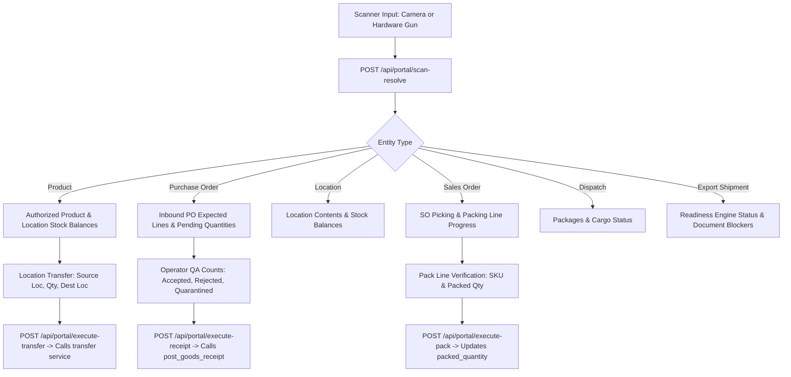

# TradeSathi AI — Phase 8: Barcode, QR Codes & Operational Portals Design Note

**Author:** Antigravity Autonomous Systems Architecture Team  
**Date:** October 14, 2026  
**Status:** Approved for Implementation  
**Target Workspace:** `C:\Users\RAHUL\Desktop\gautam\tradesathi-ai`

---

## 1. Executive Summary & Goals

Phase 8 introduces enterprise-grade barcode and QR-code tracking and a responsive Operational Portal to TradeSathi AI. It bridges physical warehouse floor operations with the digital ERP ledger across products, storage locations, purchase orders, goods receipts, sales orders, fulfilment dispatches, packages, and export shipments.

### Non-Negotiable Architectural Principles
1. **Zero Shadow Balances:** Scanning a code resolves to authoritative records in `products`, `warehouses`, `warehouse_locations`, `inventory_balances`, `purchase_orders`, `sales_orders`, and `shipments`. Scanning never creates duplicate inventory ledgers.
2. **Scan $\ne$ Stock Mutation:** Mere scanning is strictly a lookup/verification action. Any inventory-changing operation (goods receipt, location transfer, pick/pack verification, dispatch) requires explicit confirmation, executes through existing transactional services (`post_gr`, `stock_transfers`, `sales_dispatches`), and logs an immutable audit event.
3. **Database-Level Uniqueness & Idempotency:** Barcode and QR code identifiers are indexed and enforced unique at the database level. Reprinting reuses existing registered barcode rows rather than creating duplicate identities.
4. **Hardware & Camera Agnostic:** Supports mobile/tablet camera scanning via WebRTC (`html5-qrcode`) alongside instant keyboard-emulation input from industrial USB/Bluetooth handheld barcode scanners (`keypress` Enter trap).
5. **Storage Isolation:** Generated label artifacts are written strictly via `get_storage_dir() / "labels"`. Test suites write exclusively to temporary isolated directories, preventing contamination of live storage.
6. **Defense-in-Depth:** Scanned QR payloads are validated server-side. Payloads do not embed authentication tokens, passwords, customer secrets, or private personal data.

---

## 2. Barcode & QR Symbology & Payload Schema

### 2.1 Supported Symbologies
- **QR Code (2D):** Used for all internal entity identification, cross-functional lookups, label printing, and operational portal scanning. Encodes structured payload: `TS:<ENTITY_TYPE>:<IDENTIFIER>`.
- **Code 128 (1D Linear):** Used on product packaging and pallet labels for high-speed linear laser scanners. Encodes plain business identifier (e.g. `SKU-VALVE-001`, `PO-2026-0001`, `DSP-2026-0001`).

### 2.2 Standard Structured QR Payload Format (`v1`)
All QR codes generated by TradeSathi AI follow a deterministic, versioned uniform URI/string scheme:
```
TS:<VERSION>:<ENTITY_TYPE>:<PRIMARY_KEY_OR_REFERENCE>
```
Where:
- `TS`: TradeSathi AI system namespace identifier.
- `<VERSION>`: Payload schema version (`v1`).
- `<ENTITY_TYPE>`:
  - `PROD` &rarr; Product SKU or ID (`TS:v1:PROD:SKU-VALVE-100`)
  - `LOC` &rarr; Warehouse Location (`TS:v1:LOC:WH-01:A-01-01`)
  - `PO` &rarr; Purchase Order Number (`TS:v1:PO:PO-2026-0001`)
  - `GR` &rarr; Goods Receipt Number (`TS:v1:GR:GR-2026-0001`)
  - `SO` &rarr; Sales Order Number (`TS:v1:SO:SO-2026-0001`)
  - `DSP` &rarr; Sales Dispatch (`TS:v1:DSP:DISP-2026-0001`)
  - `PKG` &rarr; Package in Dispatch (`TS:v1:PKG:DISP-2026-0001:1`)
  - `EXP` &rarr; Export Shipment Reference (`TS:v1:EXP:EXP-2026-0001`)
  - `DOC` &rarr; Registered Document ID (`TS:v1:DOC:doc-190191`)

### 2.3 Universal Scanner Fallback Resolution
To support 3rd-party vendor barcodes and manual operator keypad entry, the resolution engine also accepts plain identifiers:
1. Exact SKU match in `products.sku` &rarr; resolves to Product.
2. Exact PO number in `purchase_orders.po_number` &rarr; resolves to Purchase Order.
3. Exact GR number in `goods_receipts.gr_number` &rarr; resolves to Goods Receipt.
4. Exact SO number in `sales_orders.order_number` &rarr; resolves to Sales Order.
5. Exact Dispatch number in `sales_dispatches.dispatch_number` &rarr; resolves to Dispatch.
6. Exact Shipment reference in `shipments.reference` &rarr; resolves to Export Shipment.
7. Exact Location code in `warehouse_locations.location_code` (scoped by selected warehouse) &rarr; resolves to Location.

---

## 3. Database Schema Changes (Additive & Idempotent)

We introduce a single additive table `entity_barcodes` to record registered barcodes and labels:

```sql
CREATE TABLE IF NOT EXISTS entity_barcodes (
    id TEXT PRIMARY KEY,
    entity_type TEXT NOT NULL CHECK(entity_type IN (
        'product', 'location', 'purchase_order', 'goods_receipt',
        'sales_order', 'sales_dispatch', 'dispatch_package',
        'export_shipment', 'document'
    )),
    entity_id TEXT NOT NULL,
    entity_reference TEXT NOT NULL COLLATE NOCASE,
    barcode_value TEXT NOT NULL UNIQUE COLLATE NOCASE,
    symbology TEXT NOT NULL DEFAULT 'QR_CODE' CHECK(symbology IN ('QR_CODE', 'CODE128', 'EAN13')),
    format_version TEXT NOT NULL DEFAULT 'v1',
    label_size TEXT NOT NULL DEFAULT '4x2',
    file_path TEXT,
    is_active INTEGER NOT NULL DEFAULT 1 CHECK(is_active IN (0, 1)),
    created_by TEXT NOT NULL,
    created_at TEXT NOT NULL,
    deactivated_by TEXT,
    deactivated_at TEXT,
    UNIQUE(entity_type, entity_id, symbology)
);

CREATE INDEX IF NOT EXISTS idx_barcodes_val ON entity_barcodes(barcode_value);
CREATE INDEX IF NOT EXISTS idx_barcodes_entity ON entity_barcodes(entity_type, entity_id);
CREATE INDEX IF NOT EXISTS idx_barcodes_ref ON entity_barcodes(entity_reference);
```

### Additive Columns on Existing Master Tables (if not present)
- `products.barcode`: `TEXT` (optional manufacturer EAN/UPC code)
- `warehouse_locations.barcode`: `TEXT` (optional physical shelf barcode)

---

## 4. Operational Scanning Workflows



### Workflow A: Universal Product & Location Lookup
- Scans product QR or SKU Code 128.
- Returns product details, master UOM, category, and real-time stock balances broken down by warehouse and stock type (`available`, `reserved`, `quarantined`, `rejected`, `in_transit`).
- Highlights low-stock / critical reorder alerts.

### Workflow B: Inbound Goods Receipt Portal
- Scans PO barcode (`TS:v1:PO:PO-2026-0001`).
- Returns vendor details, PO lines, ordered quantities, already-received quantities, and remaining expected quantities.
- Enables mobile warehouse operator to input accepted, rejected (with reason), and quarantined quantities.
- Confirmed submission calls existing `post_goods_receipt` service within transactional boundary. Blocks over-receipt beyond tolerance.

### Workflow C: Stock Transfer Portal
- Operator scans source location (`TS:v1:LOC:WH-01:A-01-01`), scans product SKU, enters quantity, and scans destination location (`TS:v1:LOC:WH-01:B-02-04`).
- Validates that available unreserved stock $\ge$ transfer quantity.
- Executes transfer through authoritative ledger; updates location inventory balances without double-counting.

### Workflow D: Fulfilment Pick & Pack Portal
- Operator scans Sales Order barcode (`TS:v1:SO:SO-2026-0001`).
- Displays ordered lines, reserved quantities, and packing progress.
- Operator scans item barcode before placing in box; verifies that scanned SKU belongs to order and quantity does not exceed unfulfilled order balance.

### Workflow E: Export Shipment & Cargo Portal
- Scans shipment QR (`TS:v1:EXP:EXP-2026-0001`) or dispatch package.
- Returns operational status, linked dispatches, container/seal details, package counts, and export document readiness blockers.
- Displays statutory disclaimer: *"Internal operational readiness check only; does not represent official customs clearance."*

---

## 5. Label Generation & Printing Engine

### 5.1 Thermal Label Dimensions
- Standard **4" x 2" (100mm x 50mm)** shipping & bin label format.
- Standard **2" x 1" (50mm x 25mm)** product item label format.

### 5.2 Label Layout
Each label contains:
1. **Company Header:** `TradeSathi AI Logistics & Supply Chain`
2. **Entity Title & Reference:** e.g., `PRODUCT SKU: SKU-VALVE-100` / `LOCATION: WH-01 / A-01-01`
3. **Primary QR Code:** High-contrast 2D matrix for mobile scanner.
4. **Secondary Code 128:** Linear barcode with human-readable caption.
5. **Metadata Block:** Category/UOM/Warehouse, generation timestamp, and operator ID.
6. **Security Watermark:** Format version `v1` and internal audit verification hash.

---

## 6. Security, RBAC & Auditability

### 6.1 Role-Based Access Control
| Role | Universal Lookup | Print Labels | Inbound GR Scan | Stock Transfer Scan | Fulfilment Packing Scan |
|---|:---:|:---:|:---:|:---:|:---:|
| `admin` | ✅ | ✅ | ✅ | ✅ | ✅ |
| `manager` | ✅ | ✅ | ✅ | ✅ | ✅ |
| `warehouse` | ✅ | ✅ | ✅ | ✅ | ✅ |
| `procurement`| ✅ | ✅ | ❌ | ❌ | ❌ |
| `sales` | ✅ | ✅ | ❌ | ❌ | ❌ |
| `operator` | ✅ | ❌ | ✅ | ✅ | ✅ |
| `viewer` | ✅ (Read-Only) | ❌ | ❌ | ❌ | ❌ |

### 6.2 Audit Logging
Every label generation and scanning execution records an audit event via `record_erp_audit_log`:
- `barcode.generated`: Entity type, entity ID, barcode value, label size.
- `portal.scan_lookup`: Scanned raw value, resolved entity, operator role.
- `portal.goods_receipt`: PO ID, GR ID, line items, accepted/rejected quantities.
- `portal.stock_transfer`: Source location, dest location, SKU, quantity.
- `portal.pack_verification`: Sales order ID, SKU, verified quantity.
