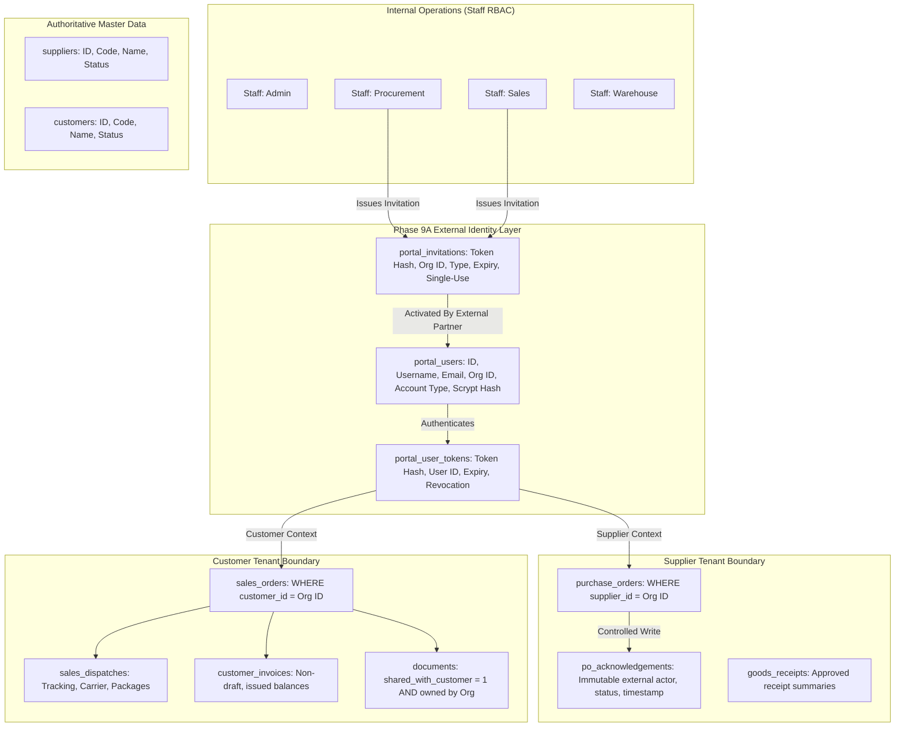

# TradeSathi AI — Phase 9: Secure Supplier & Customer Collaboration Architecture & Design Note

**Document Date:** October 15, 2026  
**Status:** Approved for Implementation (Phase 9A Foundation)  
**Author:** TradeSathi AI Architecture & Security Assurance Team  
**Scope:** Phase 9A — Secure External Identity, Tenant-Isolated Portals, Authoritative Entity Authorization, PO Acknowledgements & Document Access Controls  

---

## 1. Executive Summary & Objective

Phase 9 establishes the external collaboration foundation for TradeSathi AI. It introduces dedicated, secure access portals for external **Suppliers** and **Customers** while preserving live database integrity, maintaining backward compatibility with internal staff roles, and enforcing strict server-side multi-tenant boundaries.

Phase 9A focuses specifically on:
1. **External Identity & Account Lifecycle:** Cryptographically secure, expiring invitation tokens; scrypt password hashing; opaque bearer session tokens with instant revocation and deactivation; generic error responses preventing organization enumeration.
2. **Authoritative Master Data Association:** Supplier and customer portal users are strictly bound to existing authoritative master records (`suppliers` and `customers`). Organization ownership is resolved exclusively from authenticated database credentials—never from client headers, URL parameters, or request bodies.
3. **Strict Entity-Level Authorization (Anti-IDOR):** Supplier users can access only their own purchase orders and authorized receipt statuses. Customer users can view only their own sales orders, dispatches, issued invoices, and explicitly shared documents. All access defaults to deny.
4. **Controlled Purchase Order Acknowledgement:** A safe external write workflow enabling suppliers to accept, reject, or request clarification on eligible POs with optional comments and proposed delivery dates. Acknowledgements are immutable and idempotent, and strictly forbidden from auto-receiving goods, altering PO financial terms, or mutating inventory ledgers.
5. **Secure Document Sharing Policy:** Document downloads require explicit sharing flags and authoritative tenancy verification, with path-traversal prevention, no exposure of internal disk paths, and complete audit tracking.
6. **Zero Live Data Mutation Guarantee:** Live database (`tradesathi.db`) and document storage (`storage/documents`) remain 100% byte-for-byte immutable throughout test and verification.

---

## 2. Current Architecture & Baseline Inspection

### 2.1 Internal Staff Authentication & RBAC
- **Users Table (`users`):** Stores internal users with role constraint `CHECK(role IN ('admin', 'sales', 'warehouse', 'procurement', 'viewer'))`.
- **Session Tokens (`user_tokens`):** Stores SHA-256 hashes of 32-byte opaque bearer tokens with expiration timestamps and explicit revocation flags (`revoked = 1`).
- **Password Security:** Scrypt memory-hard key derivation (`scrypt$16384$8$1$<salt>$<hash>`) with timing-safe verification (`hmac.compare_digest`).
- **Dependency Guard (`get_current_user`):** Inspects bearer token, resolves user role from DB (ignores client `X-User-Role` headers outside test simulator), verifies `is_active = 1`, and fails closed.

### 2.2 Existing Business Entities & Tenancy References
| Entity | Primary Key | Authoritative Organization Reference | Status Lifecycle |
|---|---|---|---|
| `suppliers` | `id` (`sup-...`) | N/A (Master Tenant Organization) | `active`, `inactive` |
| `customers` | `id` (`cust-...`) | N/A (Master Tenant Organization) | `active`, `inactive` |
| `purchase_orders` | `id` (`po-...`) | `supplier_id` &rarr; `suppliers.id` | `draft` &rarr; `submitted` &rarr; `approved` &rarr; `cancelled` |
| `goods_receipts` | `id` (`gr-...`) | `supplier_id` &rarr; `suppliers.id`, `po_id` &rarr; `purchase_orders.id` | `draft` &rarr; `inspected` &rarr; `posted` &rarr; `cancelled` |
| `sales_orders` | `id` (`so-...`) | `customer_id` &rarr; `customers.id` | `draft` &rarr; `confirmed` &rarr; `allocated` &rarr; `picking` &rarr; `packed` &rarr; `dispatched` &rarr; `delivered` &rarr; `cancelled` |
| `sales_dispatches` | `id` (`disp-...`) | `sales_order_id` &rarr; `sales_orders.id` &rarr; `customer_id` | `dispatched` &rarr; `delivered` |
| `customer_invoices` | `id` (`inv-...`) | `customer_id` &rarr; `customers.id` | `draft` &rarr; `approved` &rarr; `issued` &rarr; `partially_paid` &rarr; `paid` &rarr; `overdue` &rarr; `credited` &rarr; `cancelled` |
| `documents` | `id` (`doc-...`) | `shipment_id` &rarr; `shipments.customer_id`, `sales_order_id` &rarr; `sales_orders.customer_id` | `uploaded` &rarr; `verified_by_user` / `rejected` |

### 2.3 Live Data Protection Baseline (Gate A)
- **Live Database Path:** `backend/tradesathi.db`
- **Live Database Size:** `6,127,616 bytes`
- **Live Database SHA-256:** `d16067b3369093b71457a4c22c1e0d5871e6d1201af6849a3efbfaad6090b0bf`
- **Key Table Row Counts:**
  - `analyses`: 330
  - `documents`: 48
  - `finding_reviews`: 2
  - `shipments`: 45
  - `cargo_calculations`: 0
  - `cargo_lines`: 0
- **Live Document Storage Path:** `backend/storage/documents` (143 files, manifest captured in `backend/scratch/phase9a_gate_a_baseline.json`)

---

## 3. Entity Ownership & Collaboration Architecture



---

## 4. Threat Model & Security Safeguards

| Threat Vector | Description | Phase 9A Mitigation |
|---|---|---|
| **TM-9A-01: Insecure Direct Object Reference (IDOR)** | Malicious external user tampers with `po_id`, `so_id`, `invoice_id`, or `document_id` in URL or body to access another organization's records. | Centralized server-side verification: Every query strictly filters or asserts `organization_id == current_portal_user.organization_id`. Requests targeting foreign IDs return `404 Not Found` (deny-by-default). |
| **TM-9A-02: Client Role & Organization Header Spoofing** | Attacker injects `X-User-Role: admin` or `X-Organization-Id: sup-xyz` headers. | All external identity attributes (`account_type`, `organization_id`) are resolved exclusively from verified server-side database records. Caller headers are completely ignored. |
| **TM-9A-03: Invitation Replay & Organization Hijacking** | Attacker replays an intercepted or used invitation token to register duplicate accounts or associate with a different company. | Single-use invitation tokens with cryptographic hashing (`SHA-256`), database transaction locking (`BEGIN IMMEDIATE`), and status update to `accepted`. Replayed tokens fail with HTTP 400. Server-side binds account type and organization at invitation creation time. |
| **TM-9A-04: Credential & Token Leakage** | Tokens or passwords logged in server logs or database error dumps. | Password hashing with memory-hard scrypt; opaque 256-bit bearer tokens stored only as SHA-256 hashes; sensitive fields stripped from audit logs and middleware request logs. |
| **TM-9A-05: Unauthorized Procurement Mutation** | Supplier acknowledges PO and attempts to trigger inventory receipts, price modifications, or automatic internal approval. | PO acknowledgement workflow updates only acknowledgement metadata columns (`supplier_ack_status`, `supplier_ack_at`, `supplier_ack_notes`). Internal PO status remains distinct (`submitted` or `approved`); goods receipts and inventory movements require authenticated internal staff roles (`procurement`/`warehouse`). |
| **TM-9A-06: Document Path Traversal & Cross-Tenant Theft** | Attacker uses `../` sequences or requests confidential documents (e.g. internal audit, foreign commercial invoice) via download endpoints. | File paths resolved safely inside storage directory; download endpoint asserts `shared_with_customer = 1` (or supplier) and verifies organization ownership of linked sales order/shipment. |
| **TM-9A-07: Account Enumeration via Public Endpoints** | Attacker queries invitation or login endpoints to discover registered supplier or customer identities. | Generic error messages (`"Invalid invitation token or token has expired"`, `"Invalid username or password"`); invitation endpoints require internal staff authentication (`admin`, `procurement`, `sales`). |
| **TM-9A-08: Deactivated Account Access Continuation** | Deactivated supplier or customer user continues using unexpired bearer tokens. | Immediate revocation of all active tokens in `portal_user_tokens` upon user deactivation. Authentication dependency verifies `portal_users.is_active = 1` and `revoked = 0` on every API request. |

---

## 5. Additive Database Schema & Migration Plan

All schema modifications are 100% additive and execute within `init_db()` using `CREATE TABLE IF NOT EXISTS`, `CREATE INDEX IF NOT EXISTS`, and safe `ALTER TABLE ADD COLUMN` guards.

### 5.1 New Tables

#### `portal_invitations`
```sql
CREATE TABLE IF NOT EXISTS portal_invitations (
    id TEXT PRIMARY KEY,
    invitation_token_hash TEXT NOT NULL UNIQUE,
    account_type TEXT NOT NULL CHECK(account_type IN ('supplier', 'customer')),
    organization_id TEXT NOT NULL,
    organization_name TEXT NOT NULL,
    email TEXT NOT NULL COLLATE NOCASE,
    invited_by TEXT NOT NULL,
    status TEXT NOT NULL DEFAULT 'pending' CHECK(status IN ('pending', 'accepted', 'expired', 'revoked')),
    expires_at TEXT NOT NULL,
    accepted_at TEXT,
    revoked_at TEXT,
    notes TEXT,
    created_at TEXT NOT NULL,
    updated_at TEXT NOT NULL
);
CREATE INDEX IF NOT EXISTS idx_p_inv_token ON portal_invitations(invitation_token_hash);
CREATE INDEX IF NOT EXISTS idx_p_inv_org ON portal_invitations(organization_id);
CREATE INDEX IF NOT EXISTS idx_p_inv_status ON portal_invitations(status);
```

#### `portal_users`
```sql
CREATE TABLE IF NOT EXISTS portal_users (
    id TEXT PRIMARY KEY,
    username TEXT NOT NULL UNIQUE COLLATE NOCASE,
    email TEXT NOT NULL UNIQUE COLLATE NOCASE,
    password_hash TEXT NOT NULL,
    account_type TEXT NOT NULL CHECK(account_type IN ('supplier', 'customer')),
    organization_id TEXT NOT NULL,
    organization_name TEXT NOT NULL,
    invitation_id TEXT,
    is_active INTEGER NOT NULL DEFAULT 1 CHECK(is_active IN (0, 1)),
    created_at TEXT NOT NULL,
    updated_at TEXT NOT NULL,
    FOREIGN KEY (invitation_id) REFERENCES portal_invitations(id) ON DELETE SET NULL
);
CREATE INDEX IF NOT EXISTS idx_p_users_username ON portal_users(LOWER(username));
CREATE INDEX IF NOT EXISTS idx_p_users_org ON portal_users(organization_id);
CREATE INDEX IF NOT EXISTS idx_p_users_type ON portal_users(account_type);
CREATE INDEX IF NOT EXISTS idx_p_users_active ON portal_users(is_active);
```

#### `portal_user_tokens`
```sql
CREATE TABLE IF NOT EXISTS portal_user_tokens (
    token_id TEXT PRIMARY KEY,
    portal_user_id TEXT NOT NULL,
    token_hash TEXT NOT NULL UNIQUE,
    expires_at TEXT NOT NULL,
    revoked INTEGER NOT NULL DEFAULT 0 CHECK(revoked IN (0, 1)),
    created_at TEXT NOT NULL,
    FOREIGN KEY (portal_user_id) REFERENCES portal_users(id) ON DELETE CASCADE
);
CREATE INDEX IF NOT EXISTS idx_p_tokens_hash ON portal_user_tokens(token_hash);
CREATE INDEX IF NOT EXISTS idx_p_tokens_user ON portal_user_tokens(portal_user_id);
```

#### `po_acknowledgements`
```sql
CREATE TABLE IF NOT EXISTS po_acknowledgements (
    id TEXT PRIMARY KEY,
    po_id TEXT NOT NULL,
    supplier_id TEXT NOT NULL,
    portal_user_id TEXT NOT NULL,
    portal_username TEXT NOT NULL,
    action TEXT NOT NULL CHECK(action IN ('accept', 'reject', 'request_clarification')),
    previous_ack_status TEXT,
    supplier_comments TEXT,
    proposed_delivery_date TEXT,
    idempotency_key TEXT,
    created_at TEXT NOT NULL,
    FOREIGN KEY (po_id) REFERENCES purchase_orders(id) ON DELETE RESTRICT,
    FOREIGN KEY (supplier_id) REFERENCES suppliers(id) ON DELETE RESTRICT,
    FOREIGN KEY (portal_user_id) REFERENCES portal_users(id) ON DELETE RESTRICT
);
CREATE INDEX IF NOT EXISTS idx_po_ack_po ON po_acknowledgements(po_id);
CREATE INDEX IF NOT EXISTS idx_po_ack_supplier ON po_acknowledgements(supplier_id);
CREATE INDEX IF NOT EXISTS idx_po_ack_idem ON po_acknowledgements(idempotency_key);
```

### 5.2 Additive Columns on Existing Tables
- On `purchase_orders`:
  - `supplier_ack_status` `TEXT DEFAULT 'unacknowledged' CHECK(supplier_ack_status IN ('unacknowledged', 'accepted', 'rejected', 'clarification_requested'))`
  - `supplier_ack_at` `TEXT`
  - `supplier_ack_by` `TEXT`
  - `supplier_ack_notes` `TEXT`
  - `supplier_proposed_delivery_date` `TEXT`
- On `documents`:
  - `shared_with_customer` `INTEGER NOT NULL DEFAULT 0 CHECK(shared_with_customer IN (0, 1))`
  - `shared_with_supplier` `INTEGER NOT NULL DEFAULT 0 CHECK(shared_with_supplier IN (0, 1))`
  - `shared_at` `TEXT`
  - `shared_by` `TEXT`
  - `sharing_notes` `TEXT`

### 5.3 Rollback & Idempotency Safety
Migrations run inside SQLite transactions (`BEGIN` ... `COMMIT`). If an error occurs, the transaction rolls back cleanly. Re-running migrations is completely idempotent because of `IF NOT EXISTS` table/index guards and column-existence PRAGMA inspection before executing `ALTER TABLE ADD COLUMN`.

---

## 6. Phase 9A Completion Criteria & Acceptance Gates

- **Gate A:** Live database and storage baseline captured and verified completely untouched.
- **Gate B:** External identity, secure invitations, token lifecycle, activation, and instant revocation verified.
- **Gate C:** Strict supplier and customer tenant isolation and IDOR prevention verified with synthetic tenants A and B.
- **Gate D:** Secure document sharing and authorization policy verified against cross-tenant and unshared download attempts.
- **Gate E:** Supplier PO acknowledgement workflow verified for eligibility, comments/delivery date handling, immutability, and idempotency without inventory mutation.
- **Gate F:** Secret-safe collaboration audit history verified.
- **Gate G:** Frontend portal integration verified for supplier and customer workflows.
- **Gate H:** Full test regression, 2-pass migration idempotency, and production build verification.
