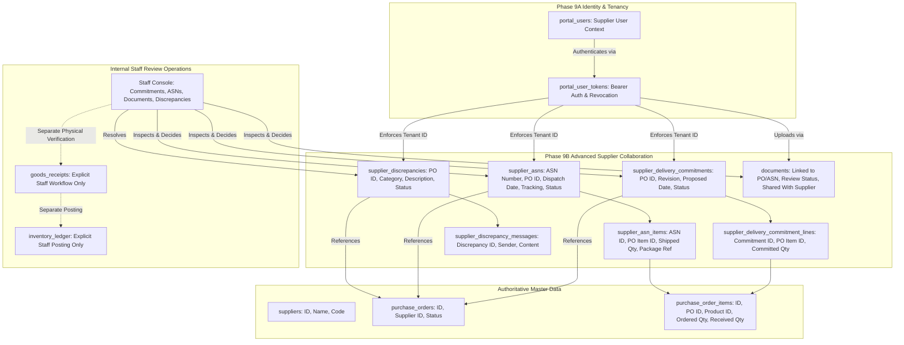
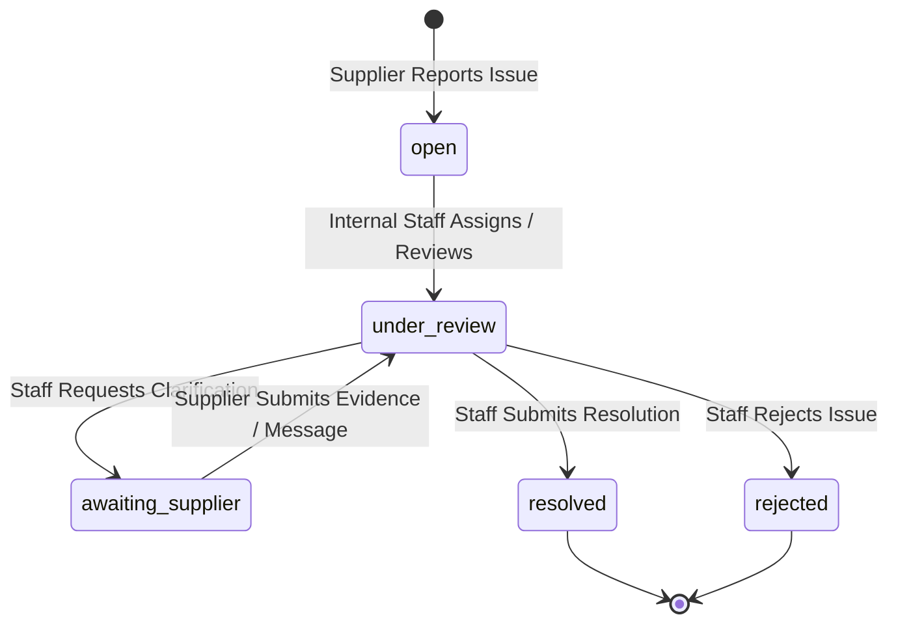

# TradeSathi AI — Phase 9B: Advanced Supplier Collaboration Architecture & Design Note

**Document Date:** October 15, 2026  
**Status:** Approved for Implementation  
**Author:** TradeSathi AI Architecture & Security Assurance Team  
**Scope:** Phase 9B — Delivery Commitments, Advance Shipment Notices (ASNs), Secure Supplier Document Submissions, Delivery Discrepancy Reporting & Internal Staff Review Console  

---

## 1. Executive Summary & Objective

Phase 9B builds directly on the secure foundation established in Phase 9A. It extends the external **Supplier Portal** with advanced collaboration capabilities while upholding strict multi-tenant isolation, data integrity, and inventory decoupled safety.

Specifically, Phase 9B introduces:
1. **Delivery Commitments & Revision History:** Suppliers can propose or revise delivery dates, ETAs, partial delivery schedules, and carrier details for their purchase orders without altering internal contractual PO terms or triggering inventory movements.
2. **Advance Shipment Notices (ASNs):** Controlled notification mechanism for outbound supplier dispatches with package counts, tracking numbers, and line-item quantity validation against remaining PO balance. ASNs act strictly as advisory advance notices and **never** post inventory, create goods receipts, or approve invoices.
3. **Secure Supplier Document Submissions:** Authenticated file uploads tied to purchase orders or ASNs with strict allowlists, magic byte verification, private storage paths, hash calculation, and an internal staff review queue (`pending_review` &rarr; `accepted` / `rejected`).
4. **Delivery Discrepancy Lifecycle:** Structured issue reporting (short shipment, damaged goods, missing documents, delays) with append-only audit trail, controlled state machine (`open` &rarr; `under_review` &rarr; `awaiting_supplier` &rarr; `resolved` / `rejected`), and strict segregation between internal staff notes and supplier-visible communications.
5. **Internal Staff Review Console:** Dedicated operational review surfaces for procurement and warehouse staff to review, approve, or reject supplier commitments, ASNs, documents, and discrepancies.
6. **Mandatory Data Protection:** Zero mutations to live database (`tradesathi.db`) or live document storage. All tests execute against isolated temporary databases and storage directories.

---

## 2. Entity Relationships & System Architecture



---

## 3. Threat Model & Security Controls

| Threat Vector | Description | Phase 9B Mitigation |
|---|---|---|
| **TM-9B-01: Cross-Supplier IDOR on Commitments / ASNs** | Supplier A submits a commitment, ASN, or discrepancy targeting Supplier B's purchase order. | Server-side verification on every request: PO is loaded with `WHERE id = ? AND supplier_id = ?`. If supplier does not own PO, API returns `HTTP 404 Not Found` (deny-by-default). |
| **TM-9B-02: Over-Shipment / Quantity Inconsistency** | Supplier submits an ASN with quantities greater than the remaining balance (`ordered_qty - received_qty`) or negative values. | Strict validation: every line's `shipped_qty` must be `> 0` and `<= (ordered_qty - received_qty)`. Total active commitments/ASNs are audited to prevent fabricated quantities. |
| **TM-9B-03: Malicious File Upload & Path Traversal** | Supplier uploads an executable file (`.exe`, `.sh`, `.php`) or uses `../../` in filenames to escape storage sandbox. | 1. Filename sanitization (`sanitize_filename`).<br>2. Storage key generated using UUID (`{po_id}/{uuid}_{safe_name}`).<br>3. Path traversal assertion (`resolved_target.relative_to(resolved_base)`).<br>4. File extension allowlist: `.pdf`, `.txt`, `.docx`, `.png`, `.jpg`, `.jpeg`.<br>5. File signature (magic bytes) validation.<br>6. Strict 10MB size limit. |
| **TM-9B-04: Unauthorized Internal Decision Tampering** | Supplier attempts to set discrepancy status to `resolved`, approve their own commitment, or view confidential internal notes. | 1. Supplier endpoints permit only submission of records and messages.<br>2. Status updates and approvals require authenticated internal staff credentials (`get_current_user` with `procurement` or `admin`).<br>3. Discrepancy table separates `internal_notes` (never returned to supplier) from `shared_resolution_notes`. |
| **TM-9B-05: Premature Inventory / Receipt Inflation** | Supplier submits an ASN and attempts to treat it as a goods receipt or automatically increase warehouse inventory balances. | Decoupled architecture: ASNs and commitments update **only** collaboration tables. They do **not** write to `goods_receipts`, `goods_receipt_items`, or `inventory_ledger`. Goods receipt and stock posting remain strictly manual, multi-step staff operations. |
| **TM-9B-06: ASN Replay & Concurrent Submissions** | Supplier fires duplicate or concurrent ASN creation requests with the same dispatch reference. | Unique database constraint `UNIQUE(supplier_id, dispatch_reference)`. Idempotency key tracking: identical payload returns existing ASN; modified payload returns `HTTP 409 Conflict`. Database transactions wrap master-detail inserts. |
| **TM-9B-07: Inadvertent Document Leakage to Customers** | Supplier uploads supporting document for a PO, which is accidentally exposed to customer portal users. | Additive document columns: `shared_with_customer = 0` by default. Customer document download endpoint explicitly verifies `shared_with_customer = 1` and customer organization ownership. |
| **TM-9B-08: Partial Failure / Ghost File Storage** | File is written to disk but database transaction crashes, or vice versa, leaving inconsistent state. | Controlled order of operations: compute hash and validate file in-memory; open database transaction; write file; insert DB record; commit transaction. On database exception, unlink written file and rollback. |

---

## 4. Additive Database Schema

All migrations are additive, idempotent, and executable via `init_db()` using `CREATE TABLE IF NOT EXISTS` and `ALTER TABLE ADD COLUMN`.

### 4.1 `supplier_delivery_commitments`
```sql
CREATE TABLE IF NOT EXISTS supplier_delivery_commitments (
    id TEXT PRIMARY KEY,
    po_id TEXT NOT NULL REFERENCES purchase_orders(id),
    supplier_id TEXT NOT NULL REFERENCES suppliers(id),
    revision_number INTEGER NOT NULL DEFAULT 1,
    proposed_delivery_date TEXT NOT NULL,
    supplier_dispatch_ref TEXT,
    carrier_name TEXT,
    tracking_number TEXT,
    supplier_comments TEXT,
    status TEXT NOT NULL DEFAULT 'proposed' CHECK(status IN ('proposed', 'accepted', 'rejected', 'superseded')),
    internal_review_notes TEXT,
    reviewed_by TEXT,
    reviewed_at TEXT,
    idempotency_key TEXT,
    created_by TEXT NOT NULL,
    created_at TEXT NOT NULL,
    updated_at TEXT NOT NULL
);
CREATE INDEX IF NOT EXISTS idx_sdc_po ON supplier_delivery_commitments(po_id);
CREATE INDEX IF NOT EXISTS idx_sdc_supplier ON supplier_delivery_commitments(supplier_id);
CREATE INDEX IF NOT EXISTS idx_sdc_status ON supplier_delivery_commitments(status);
```

### 4.2 `supplier_delivery_commitment_lines`
```sql
CREATE TABLE IF NOT EXISTS supplier_delivery_commitment_lines (
    id TEXT PRIMARY KEY,
    commitment_id TEXT NOT NULL REFERENCES supplier_delivery_commitments(id) ON DELETE CASCADE,
    po_item_id TEXT NOT NULL REFERENCES purchase_order_items(id),
    product_id TEXT NOT NULL,
    committed_qty REAL NOT NULL CHECK(committed_qty > 0),
    created_at TEXT NOT NULL
);
CREATE INDEX IF NOT EXISTS idx_sdcl_commitment ON supplier_delivery_commitment_lines(commitment_id);
```

### 4.3 `supplier_asns`
```sql
CREATE TABLE IF NOT EXISTS supplier_asns (
    id TEXT PRIMARY KEY,
    asn_number TEXT NOT NULL UNIQUE,
    po_id TEXT NOT NULL REFERENCES purchase_orders(id),
    supplier_id TEXT NOT NULL REFERENCES suppliers(id),
    dispatch_reference TEXT NOT NULL,
    package_count INTEGER NOT NULL DEFAULT 1 CHECK(package_count >= 0),
    carrier_name TEXT,
    tracking_number TEXT,
    dispatch_date TEXT NOT NULL,
    expected_arrival_date TEXT NOT NULL,
    status TEXT NOT NULL DEFAULT 'submitted' CHECK(status IN ('submitted', 'acknowledged', 'received', 'cancelled')),
    notes TEXT,
    idempotency_key TEXT,
    created_by TEXT NOT NULL,
    created_at TEXT NOT NULL,
    updated_at TEXT NOT NULL,
    CONSTRAINT uq_supplier_asn_dispatch UNIQUE (supplier_id, dispatch_reference)
);
CREATE INDEX IF NOT EXISTS idx_asn_po ON supplier_asns(po_id);
CREATE INDEX IF NOT EXISTS idx_asn_supplier ON supplier_asns(supplier_id);
CREATE INDEX IF NOT EXISTS idx_asn_status ON supplier_asns(status);
```

### 4.4 `supplier_asn_items`
```sql
CREATE TABLE IF NOT EXISTS supplier_asn_items (
    id TEXT PRIMARY KEY,
    asn_id TEXT NOT NULL REFERENCES supplier_asns(id) ON DELETE CASCADE,
    po_item_id TEXT NOT NULL REFERENCES purchase_order_items(id),
    product_id TEXT NOT NULL,
    sku TEXT NOT NULL,
    product_name TEXT NOT NULL,
    uom TEXT NOT NULL,
    shipped_qty REAL NOT NULL CHECK(shipped_qty > 0),
    package_label TEXT,
    created_at TEXT NOT NULL
);
CREATE INDEX IF NOT EXISTS idx_asni_asn ON supplier_asn_items(asn_id);
```

### 4.5 `supplier_discrepancies`
```sql
CREATE TABLE IF NOT EXISTS supplier_discrepancies (
    id TEXT PRIMARY KEY,
    discrepancy_number TEXT NOT NULL UNIQUE,
    supplier_id TEXT NOT NULL REFERENCES suppliers(id),
    po_id TEXT NOT NULL REFERENCES purchase_orders(id),
    asn_id TEXT REFERENCES supplier_asns(id),
    commitment_id TEXT REFERENCES supplier_delivery_commitments(id),
    category TEXT NOT NULL CHECK(category IN ('quantity_mismatch', 'short_shipment', 'damaged_goods', 'delayed_shipment', 'incorrect_product', 'missing_documentation', 'other')),
    title TEXT NOT NULL,
    description TEXT NOT NULL,
    status TEXT NOT NULL DEFAULT 'open' CHECK(status IN ('open', 'under_review', 'awaiting_supplier', 'resolved', 'closed', 'rejected')),
    internal_notes TEXT,
    shared_resolution_notes TEXT,
    resolved_by TEXT,
    resolved_at TEXT,
    created_by TEXT NOT NULL,
    created_at TEXT NOT NULL,
    updated_at TEXT NOT NULL
);
CREATE INDEX IF NOT EXISTS idx_sdisc_supplier ON supplier_discrepancies(supplier_id);
CREATE INDEX IF NOT EXISTS idx_sdisc_po ON supplier_discrepancies(po_id);
CREATE INDEX IF NOT EXISTS idx_sdisc_status ON supplier_discrepancies(status);
```

### 4.6 `supplier_discrepancy_messages`
```sql
CREATE TABLE IF NOT EXISTS supplier_discrepancy_messages (
    id TEXT PRIMARY KEY,
    discrepancy_id TEXT NOT NULL REFERENCES supplier_discrepancies(id) ON DELETE CASCADE,
    sender_type TEXT NOT NULL CHECK(sender_type IN ('supplier', 'staff')),
    sender_id TEXT NOT NULL,
    sender_name TEXT NOT NULL,
    message TEXT NOT NULL,
    attachments_json TEXT NOT NULL DEFAULT '[]',
    created_at TEXT NOT NULL
);
CREATE INDEX IF NOT EXISTS idx_sdmsg_disc ON supplier_discrepancy_messages(discrepancy_id);
```

### 4.7 Additive Columns on `documents`
- `review_status TEXT DEFAULT 'verified_by_user'` (`pending_review`, `accepted`, `rejected`, `replacement_requested`)
- `review_notes TEXT`
- `reviewed_by TEXT`
- `reviewed_at TEXT`
- `asn_id TEXT REFERENCES supplier_asns(id)`
- `po_id TEXT REFERENCES purchase_orders(id)`

---

## 5. Discrepancy Lifecycle State Machine



- **Rules:**
  - Suppliers can only transition from `awaiting_supplier` back to `under_review` by posting a message or uploading evidence.
  - Only staff with `procurement` or `admin` role can mark a discrepancy `under_review`, `resolved`, or `rejected`.
  - Discrepancy status updates emit append-only events to `audit_log`.
  - `internal_notes` are strictly scrubbed before responses are returned to supplier callers.

---

## 6. Migration & Safe Rollback Plan

1. **Idempotent 2-Pass Migration:**
   - Execute `init_db()` across schema definitions.
   - Run verification test asserting table creation, constraints, and trigger installations.
2. **Rollback Strategy:**
   - Because all changes are additive, rollback involves simply removing the router mounts in `main.py` without modifying existing core tables (`purchase_orders`, `goods_receipts`, `inventory_ledger`).
3. **Data Safety Assurance:**
   - Hash comparisons of `tradesathi.db` and live storage manifests captured before and after verification. Zero mutations tolerated.
