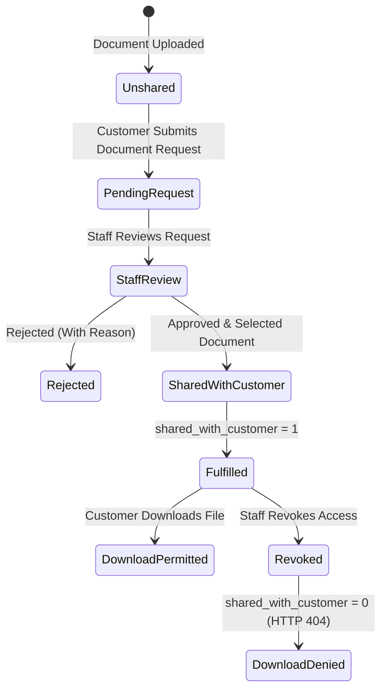

# TradeSathi AI — Phase 9C: Customer Collaboration & Order Communication Design Note

**Date**: October 15, 2026  
**Status**: APPROVED FOR IMPLEMENTATION  
**Author**: DeepMind Advanced Agentic Coding Pair  
**Scope**: Customer Order Communication, Document Requests, Enhanced Visibility, and Staff Fulfillment  

---

## 1. Executive Summary & Architectural Invariants

Phase 9C extends TradeSathi AI's collaboration architecture to provide secure, authenticated customer communication and document fulfillment capabilities. Building on the foundation established in Phase 9A (External Portals and Identity) and Phase 9B (Supplier Portals & Review Consoles), Phase 9C introduces controlled customer write operations while strictly defending core business and financial invariants.

### Key Architectural Invariants:
1. **Limited Customer Write Operations**:
   Customers are permitted to write **strictly** messages in order-specific discussion threads and formal document requests.
2. **Absolute Commercial & Operational Immunity**:
   Customer collaboration actions must **never** modify sales order pricing, incoterms, payment terms, or status.
   They must **never** approve invoices, record customer payments, modify inventory allocations, create shipments, or trigger warehouse picking/dispatching.
3. **Private-By-Default Document Governance**:
   Document requests never automatically grant access to unshared files or fabricate statutory certificates.
   A document is accessible to a customer if and only if:
   - It is authoritatively associated with a sales order or shipment owned by the customer's organization.
   - `shared_with_customer == 1` has been explicitly authorized by internal staff.
   - The customer account is active and authenticated.
   Revoking document sharing (`shared_with_customer = 0`) instantly denies download access without cached authorization loopholes.
4. **Strict Staff Secrecy**:
   Internal staff resolution notes, internal thread messages (`is_internal_note = 1`), financial margin analyses, supplier costs, and draft/cancelled invoices are permanently inaccessible to external customer accounts.
5. **Zero Live Database Mutation During Tests**:
   Live database `backend/tradesathi.db` and live storage `backend/storage/documents` are protected by automated pre/post SHA-256 and file size comparison gates. All testing utilizes isolated in-memory or ephemeral databases.

---

## 2. Threat Model & Security Mitigations

| Threat Vector | Attack Scenario | Defensive Architecture in Phase 9C |
| :--- | :--- | :--- |
| **Cross-Customer IDOR** | Customer A attempts to view Customer B's sales orders, messages, invoices, or document requests by manipulating URL IDs. | Server-side tenant isolation: Every query filters by `customer_id = current_user.organization_id`. Cross-tenant requests return `HTTP 404` to avoid leaking resource existence. |
| **Internal Data Leakage** | Customer attempts to inspect staff notes, supplier prices, or draft invoices. | `customer_invoices` queries enforce `status NOT IN ('draft', 'cancelled')`. `customer_order_threads` queries omit `internal_notes`. Messages where `is_internal_note = 1` are filtered out. |
| **XSS & Injection Payloads** | Malicious customer injects HTML `<script>` or event handlers into thread message bodies or request notes. | Messages are treated strictly as plain text, length-limited, and rendered safely in React components with text-node escaping. |
| **Fabricated Certificate Exploits** | Customer requests a Certificate of Origin or Quality Inspection, expecting the system to generate a statutory certificate automatically. | The system rejects automatic generation. Document requests require internal staff review and manual linkage to an authorized, pre-verified document. |
| **Replay & Concurrency Attacks** | Concurrent network requests submit duplicate messages or requests simultaneously. | Requests accept an optional `X-Idempotency-Key` and enforce unique constraints on request tokens. Database transactions use `BEGIN IMMEDIATE` to prevent race conditions. |
| **Account Deactivation Bypass** | A deactivated customer portal user attempts to query threads or download previously shared files. | `get_current_portal_user` validates token validity against `portal_users.is_active = 1` on every request. Token revocation is instantaneous. |

---

## 3. Additive Schema Design

All schema changes are strictly additive and idempotent (`CREATE TABLE IF NOT EXISTS`, `CREATE INDEX IF NOT EXISTS`).

### 3.1 Table: `customer_order_threads`
Maintains customer-to-staff discussion threads linked to customer-owned sales orders.
```sql
CREATE TABLE IF NOT EXISTS customer_order_threads (
    id TEXT PRIMARY KEY,                       -- e.g. thrd-8f19b2a7
    sales_order_id TEXT NOT NULL REFERENCES sales_orders(id),
    customer_id TEXT NOT NULL REFERENCES customers(id),
    subject TEXT NOT NULL,                     -- Validated subject line (max 200 chars)
    status TEXT NOT NULL DEFAULT 'open' CHECK(status IN ('open', 'under_review', 'resolved', 'closed')),
    internal_notes TEXT,                       -- Private staff notes (never sent to customer)
    last_message_at TEXT NOT NULL,
    created_by TEXT NOT NULL,                  -- User ID or username of creator
    created_at TEXT NOT NULL,
    updated_at TEXT NOT NULL
);
CREATE INDEX IF NOT EXISTS idx_cothr_so ON customer_order_threads(sales_order_id);
CREATE INDEX IF NOT EXISTS idx_cothr_cust ON customer_order_threads(customer_id);
CREATE INDEX IF NOT EXISTS idx_cothr_status ON customer_order_threads(status);
```

### 3.2 Table: `customer_order_messages`
Append-only conversation messages within an order thread.
```sql
CREATE TABLE IF NOT EXISTS customer_order_messages (
    id TEXT PRIMARY KEY,                       -- e.g. cmsg-4e2a9b1c
    thread_id TEXT NOT NULL REFERENCES customer_order_threads(id) ON DELETE CASCADE,
    sender_type TEXT NOT NULL CHECK(sender_type IN ('customer', 'staff')),
    sender_id TEXT NOT NULL,
    sender_name TEXT NOT NULL,
    message TEXT NOT NULL,                     -- Validated message content (1 to 2000 chars)
    is_internal_note INTEGER NOT NULL DEFAULT 0 CHECK(is_internal_note IN (0, 1)),
    idempotency_key TEXT,
    created_at TEXT NOT NULL
);
CREATE INDEX IF NOT EXISTS idx_comsg_thread ON customer_order_messages(thread_id);
CREATE INDEX IF NOT EXISTS idx_comsg_idem ON customer_order_messages(idempotency_key);
```

### 3.3 Table: `customer_document_requests`
Formal requests submitted by customers for commercial or shipment documentation.
```sql
CREATE TABLE IF NOT EXISTS customer_document_requests (
    id TEXT PRIMARY KEY,                       -- e.g. dreq-1b8e4f2a
    request_number TEXT NOT NULL UNIQUE,       -- e.g. DOCREQ-20261015-0001
    customer_id TEXT NOT NULL REFERENCES customers(id),
    sales_order_id TEXT NOT NULL REFERENCES sales_orders(id),
    shipment_id TEXT REFERENCES shipments(id),
    document_category TEXT NOT NULL CHECK(document_category IN (
        'commercial_invoice', 'packing_list', 'shipping_bill', 'bill_of_lading',
        'certificate_of_origin', 'quality_certificate', 'inspection_certificate', 'other'
    )),
    message TEXT,                              -- Customer justification or specific requirement
    status TEXT NOT NULL DEFAULT 'open' CHECK(status IN ('open', 'under_review', 'fulfilled', 'rejected')),
    fulfilled_document_id TEXT REFERENCES documents(id),
    staff_decision_notes TEXT,                 -- Reason if rejected or fulfillment commentary
    reviewed_by TEXT,
    reviewed_at TEXT,
    idempotency_key TEXT,
    created_by TEXT NOT NULL,
    created_at TEXT NOT NULL,
    updated_at TEXT NOT NULL
);
CREATE INDEX IF NOT EXISTS idx_cdreq_cust ON customer_document_requests(customer_id);
CREATE INDEX IF NOT EXISTS idx_cdreq_so ON customer_document_requests(sales_order_id);
CREATE INDEX IF NOT EXISTS idx_cdreq_status ON customer_document_requests(status);
```

### 3.4 Table: `collaboration_notifications`
Notification log recording key collaboration events for customers and internal staff.
```sql
CREATE TABLE IF NOT EXISTS collaboration_notifications (
    id TEXT PRIMARY KEY,                       -- e.g. notif-3c819d4f
    recipient_type TEXT NOT NULL CHECK(recipient_type IN ('customer', 'supplier', 'staff')),
    recipient_id TEXT NOT NULL,                -- customer_id, supplier_id, or staff user_id
    event_type TEXT NOT NULL CHECK(event_type IN (
        'customer_message', 'staff_reply', 'document_request_status',
        'document_shared', 'document_revoked', 'shipment_update'
    )),
    title TEXT NOT NULL,
    message TEXT NOT NULL,
    reference_type TEXT,                       -- sales_order, thread, document_request, document
    reference_id TEXT,
    is_read INTEGER NOT NULL DEFAULT 0 CHECK(is_read IN (0, 1)),
    created_at TEXT NOT NULL
);
CREATE INDEX IF NOT EXISTS idx_cnotif_recip ON collaboration_notifications(recipient_type, recipient_id, is_read);
```

---

## 4. API Surface Specification

### 4.1 Customer-Facing Endpoints (`/api/portal/customer/*`)
Requires valid Bearer token for an active `customer` account.

- `POST /sales-orders/{so_id}/threads`: Create a new message thread linked to an authorized sales order.
- `GET /sales-orders/{so_id}/threads`: List message threads for a sales order.
- `GET /threads/{thread_id}`: Retrieve thread details and message history (internal notes filtered out).
- `POST /threads/{thread_id}/messages`: Append customer message to an open/under_review thread.
- `POST /sales-orders/{so_id}/document-requests`: Submit a formal document request.
- `GET /document-requests`: List customer document requests with status filters.
- `GET /document-requests/{id}`: View document request details.
- `GET /notifications`: View customer notifications.
- `POST /notifications/{id}/read`: Mark notification as read.

### 4.2 Internal Staff Review Endpoints (`/api/portal/admin/*`)
Requires staff role (`procurement`, `admin`, `warehouse`, `manager`, `sales`).

- `GET /customer-threads`: List all customer order threads with filter by status or customer.
- `GET /customer-threads/{thread_id}`: View complete thread history including internal notes.
- `POST /customer-threads/{thread_id}/messages`: Staff post message or private internal note.
- `POST /customer-threads/{thread_id}/status`: Transition thread status (`open`, `under_review`, `resolved`, `closed`).
- `GET /customer-document-requests`: List pending and historical document requests.
- `GET /customer-document-requests/{id}`: View document request detail.
- `POST /customer-document-requests/{id}/review`: Staff fulfillment or rejection. When fulfilled, validates document ownership and sets `documents.shared_with_customer = 1`.
- `POST /documents/{doc_id}/share`: Explicitly grant or revoke customer or supplier sharing access.

---

## 5. Explicit Document-Sharing & Revocation Workflow



---

## 6. Verification & Acceptance Gates Preview

- **Gate A**: Live database and document-storage safety (0 bytes altered).
- **Gate B**: Customer tenant isolation and authentication.
- **Gate C**: Message integrity and internal-note confidentiality.
- **Gate D**: Document-request lifecycle and authorization.
- **Gate E**: Explicit sharing, revocation, and secure downloads.
- **Gate F**: Staff permissions and audit history.
- **Gate G**: No unintended financial, inventory, or procurement mutations.
- **Gate H**: Full regression, migration integrity, and production build.

Phase 9C will be finalized once all gates pass and documentation is verified.
