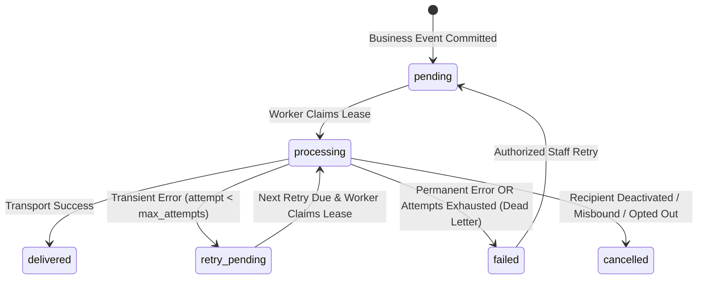

# TradeSathi AI — Phase 9D: Reliable Notifications & Collaboration Automation Design Note

**Document Date:** October 15, 2026  
**Status:** Approved for Implementation (Phase 9D)  
**Author:** TradeSathi AI Architecture & Security Assurance Team  
**Scope:** Phase 9D — Reliable In-App Notification Delivery, Transactional Outbox & Event Deduplication, Configurable Email Delivery Abstraction, Bounded Retries & Leases, Recipient Eligibility Guards, and Staff Operational Monitoring  

---

## 1. Executive Summary & Objective

Phase 9D extends the supplier and customer collaboration system established across Phases 9A, 9B, and 9C with reliable, auditable notification delivery and event-driven collaboration automation.

Key architectural goals:
1. **Durable, Reliable Event Creation:** Transition from best-effort notifications to durable, transactionally-coupled event creation. Notifications must never be emitted for business transactions that roll back, and retried requests must never create duplicate notifications.
2. **In-App Notification Reliability:** Extend the existing `collaboration_notifications` data model with delivery lifecycle states (`pending`, `processing`, `delivered`, `retry_pending`, `failed`, `cancelled`), retry counters, leases, and error categorization, while strictly maintaining independence between delivery status and in-app read/unread status.
3. **Optional Email Delivery Abstraction:** Provide an extensible email transport interface (`EmailTransport`) with a `MockEmailTransport` for deterministic, zero-egress automated tests, a `DisabledEmailTransport` when unconfigured, and an `SmtpEmailTransport` for production deployments. External email delivery is disabled by default.
4. **Resilient Retry & Concurrency Control:** Support bounded retries with exponential backoff, transient vs. permanent error classification, and lease-based atomic claims (`claimed_by`, `lease_expires_at`) preventing duplicate deliveries in multi-worker environments.
5. **Runtime Recipient Eligibility:** Re-evaluate recipient account status (`is_active = 1`) and organization binding at delivery execution time to prevent information leakage to deactivated or reassigned users.
6. **Staff Operational Monitoring:** Expose authorized internal operational metrics (pending/delivered/failed counts, dead-letter queue, oldest pending age, provider status) and allow staff to reprocess exhausted failures without mutating business data.
7. **Strict Non-Negotiable Data Safety:** Live database (`tradesathi.db`) and document storage (`storage/documents`) remain 100% byte-for-byte immutable throughout test and verification.

---

## 2. Baseline & Non-Negotiable Data Safety (Gate A)

### 2.1 Live Baseline Invariant
All tests, schema migrations, and operational evaluations must run on isolated temporary databases and sandboxed storage directories. The live database and storage must match the baseline exactly:
- **Live DB File Size:** `6,127,616 bytes`
- **Live DB SHA-256:** `d16067b3369093b71457a4c22c1e0d5871e6d1201af6849a3efbfaad6090b0bf`
- **Critical Row Counts:**
  - `analyses`: 330
  - `cargo_calculations`: 0
  - `cargo_lines`: 0
  - `documents`: 48
  - `finding_reviews`: 2
  - `shipments`: 45
- **Document Storage:** 143 files in `backend/storage/documents`.

### 2.2 Safety Principles
- Never send automated test emails to real email addresses or third-party SMTP servers.
- Never log passwords, bearer tokens, SMTP secrets, or internal server paths.
- All schema alterations are additive and idempotent.
- Notification processing must NEVER mutate inventory ledgers, purchase order pricing, invoice balances, reservations, or document-sharing flags.

---

## 3. Authoritative Notification Event Model

Events are strictly derived from authoritative business actions implemented in Phases 9A, 9B, and 9C:

| Event Domain | Event Type | Triggering Source Workflow | Target Recipient | Intended Payload Content |
| :--- | :--- | :--- | :--- | :--- |
| **Supplier** | `po_acknowledged` | Supplier submits PO acknowledgement | Staff | PO #, Supplier name, action (accept/reject/clarify) |
| **Supplier** | `commitment_submitted` | Supplier submits delivery commitment | Staff | PO #, Supplier name, proposed delivery date |
| **Supplier** | `commitment_reviewed` | Staff approves/rejects commitment | Supplier | PO #, approval status, staff review notes |
| **Supplier** | `asn_submitted` | Supplier registers Advance Shipment Notice | Staff | ASN #, PO #, dispatch reference, package count |
| **Supplier** | `asn_acknowledged` | Staff acknowledges ASN | Supplier | ASN #, PO #, acknowledgement status |
| **Supplier** | `supplier_doc_submitted` | Supplier uploads commercial document | Staff | Filename, PO #, document type |
| **Supplier** | `supplier_doc_reviewed` | Staff approves/rejects supplier document | Supplier | Filename, review decision, staff notes |
| **Supplier** | `discrepancy_created` | Supplier reports delivery discrepancy | Staff | Discrepancy #, category, PO # |
| **Supplier** | `discrepancy_resolved` | Staff resolves/updates discrepancy | Supplier | Discrepancy #, new status, resolution notes |
| **Customer** | `customer_thread_created` | Customer opens order inquiry thread | Staff | Order #, customer name, subject |
| **Customer** | `customer_message` | Customer replies to order thread | Staff | Order #, thread subject, snippet |
| **Customer** | `staff_reply` | Staff replies to customer thread | Customer | Order #, thread subject, staff reply snippet |
| **Customer** | `document_request_created` | Customer requests document for SO | Staff | Request #, Order #, requested document category |
| **Customer** | `document_request_status` | Staff reviews customer document request | Customer | Request #, status (under_review / rejected) |
| **Customer** | `document_shared` | Staff shares document / fulfills request | Customer | Request # / Order #, clean document filename |
| **Customer** | `document_revoked` | Staff revokes document sharing | Customer | Document notice (access discontinued) |
| **Customer** | `shipment_update` | Dispatch status updated for sales order | Customer | Order #, dispatch reference, carrier tracking |

*Unsupported Events:* Automated payment debit alerts, external customs clearance pushes, or automated statutory certification events do not exist in the authoritative domain and are omitted.

---

## 4. Database Schema: Additive Notification Outbox & Preferences

We adapt `collaboration_notifications` additively and introduce a lightweight user preference table:

```sql
-- 1. Enhance collaboration_notifications with delivery lifecycle & lease columns
ALTER TABLE collaboration_notifications ADD COLUMN delivery_status TEXT NOT NULL DEFAULT 'delivered' CHECK(delivery_status IN ('pending', 'processing', 'delivered', 'retry_pending', 'failed', 'cancelled'));
ALTER TABLE collaboration_notifications ADD COLUMN delivery_channel TEXT NOT NULL DEFAULT 'in_app' CHECK(delivery_channel IN ('in_app', 'email'));
ALTER TABLE collaboration_notifications ADD COLUMN idempotency_key TEXT;
ALTER TABLE collaboration_notifications ADD COLUMN recipient_email TEXT;
ALTER TABLE collaboration_notifications ADD COLUMN attempt_count INTEGER NOT NULL DEFAULT 0;
ALTER TABLE collaboration_notifications ADD COLUMN max_attempts INTEGER NOT NULL DEFAULT 3;
ALTER TABLE collaboration_notifications ADD COLUMN last_attempt_at TEXT;
ALTER TABLE collaboration_notifications ADD COLUMN next_retry_at TEXT;
ALTER TABLE collaboration_notifications ADD COLUMN claimed_by TEXT;
ALTER TABLE collaboration_notifications ADD COLUMN claimed_at TEXT;
ALTER TABLE collaboration_notifications ADD COLUMN lease_expires_at TEXT;
ALTER TABLE collaboration_notifications ADD COLUMN error_message TEXT;
ALTER TABLE collaboration_notifications ADD COLUMN error_class TEXT CHECK(error_class IN ('transient', 'permanent', NULL));
ALTER TABLE collaboration_notifications ADD COLUMN provider_message_id TEXT;
ALTER TABLE collaboration_notifications ADD COLUMN updated_at TEXT;

CREATE UNIQUE INDEX IF NOT EXISTS uq_cnotif_idem ON collaboration_notifications(idempotency_key) WHERE idempotency_key IS NOT NULL;
CREATE INDEX IF NOT EXISTS idx_cnotif_delivery ON collaboration_notifications(delivery_status, next_retry_at, lease_expires_at);

-- 2. User Notification Preferences Table
CREATE TABLE IF NOT EXISTS portal_user_notification_preferences (
    user_id TEXT PRIMARY KEY REFERENCES portal_users(id) ON DELETE CASCADE,
    email_notifications_enabled INTEGER NOT NULL DEFAULT 1 CHECK(email_notifications_enabled IN (0, 1)),
    created_at TEXT NOT NULL,
    updated_at TEXT NOT NULL
);
```

---

## 5. Delivery State Machine & Retry Lifecycle



### 5.1 Lease-Based Atomic Claims
To ensure multi-worker safety and avoid race conditions or double deliveries:
```sql
UPDATE collaboration_notifications
SET delivery_status = 'processing',
    claimed_by = :worker_id,
    claimed_at = :now,
    lease_expires_at = :lease_expiry,
    attempt_count = attempt_count + 1,
    last_attempt_at = :now,
    updated_at = :now
WHERE id IN (
    SELECT id FROM collaboration_notifications
    WHERE delivery_status IN ('pending', 'retry_pending')
      AND (lease_expires_at IS NULL OR lease_expires_at <= :now)
      AND (next_retry_at IS NULL OR next_retry_at <= :now)
    ORDER BY created_at ASC
    LIMIT :batch_size
);
```

### 5.2 Exponential Backoff
For transient failures:
$$\text{delay\_seconds} = \min(300, 5 \times 2^{(\text{attempt} - 1)})$$
- Attempt 1 failure: retry after 5 seconds.
- Attempt 2 failure: retry after 10 seconds.
- Attempt 3 failure: transitioned to `failed` (`error_class = 'transient'`).

---

## 6. Email Transport Interface & Security Architecture

```python
class EmailDeliveryResult:
    success: bool
    provider_message_id: str | None = None
    error_message: str | None = None
    error_class: Literal["transient", "permanent"] | None = None

class EmailTransport(ABC):
    @abstractmethod
    def send_email(self, to_email: str, subject: str, text_body: str, html_body: str | None = None) -> EmailDeliveryResult:
        pass
```

### 6.1 Transports
1. **`MockEmailTransport`:** In-memory queue for deterministic testing. Simulates transient timeouts and permanent bounces without network egress.
2. **`DisabledEmailTransport`:** Default production transport when `EMAIL_DELIVERY_ENABLED != "true"`. Marks deliveries cleanly as skipped/disabled without errors.
3. **`SmtpEmailTransport`:** Standard TLS/STARTTLS SMTP transport utilizing environment variables (`SMTP_HOST`, `SMTP_PORT`, `SMTP_USER`, `SMTP_PASSWORD`, `SMTP_FROM_EMAIL`).

### 6.2 Email Content Minimization & Anti-Leakage
- Notifications contain **only clean summaries and deep links** to the portal (e.g. `https://tradesathi.local/portal?tab=customer&subtab=orders`).
- Notifications NEVER include raw file contents, storage keys, server filesystem paths, bearer tokens, or confidential staff-only notes.

---

## 7. Recipient Eligibility & Tenant Isolation Verification

At delivery execution time:
1. If recipient is a portal user (`customer` or `supplier`):
   - Check `portal_users.is_active == 1`. If `0`, immediately abort delivery and set status to `cancelled` with `error_message = "Recipient account is deactivated"`.
   - Check organization association matches the business entity organization.
2. In-app notification endpoints (`/api/portal/customer/notifications`, `/api/portal/supplier/notifications`) query strictly with:
   `WHERE recipient_type = :user_type AND recipient_id = :org_id`.
   Changing IDs in requests cannot fetch or acknowledge another tenant's notifications.

---

## 8. Staff Operational Monitoring & Admin Console

New administrative endpoints:
- `GET /api/portal/admin/notifications/monitoring`: Real-time operational overview:
  - Counts: `pending`, `processing`, `delivered`, `retry_pending`, `failed`, `cancelled`.
  - `oldest_pending_age_seconds`: Age of oldest pending delivery.
  - `last_successful_delivery_at`: Timestamp of most recent delivery.
  - `provider_status`: Provider mode (`mock`, `disabled`, `smtp`).
  - `recent_failures`: List of recent failed delivery attempts with error classes.
- `POST /api/portal/admin/notifications/{id}/retry`: Reset an exhausted/failed delivery record to `pending` with `attempt_count = 0`.

---

## 9. Verification Gates & Acceptance Criteria

- **Gate A:** Live database size (`6,127,616 bytes`), SHA-256 (`d16067b3...`), and storage files (143) confirmed 100% unaltered.
- **Gate B:** Event creation occurs only upon committed transactions; rollbacks emit zero notifications.
- **Gate C:** Idempotent event creation prevents duplicates on API retries; atomic leases prevent concurrent worker race conditions.
- **Gate D:** Multi-tenant in-app notification queries strictly enforce organization boundaries.
- **Gate E:** Bounded retries (max 3), exponential backoff, and dead-letter queue behavior verified.
- **Gate F:** Zero outbound email during tests (verified via `MockEmailTransport`); `DisabledEmailTransport` verified when unconfigured.
- **Gate G:** Scrubbing verified: zero passwords, tokens, storage keys, or staff internal notes exposed in notification records or logs.
- **Gate H:** 100% test pass across Phase 9D, Phase 9A/9B/9C regressions, full suite, and frontend build.
